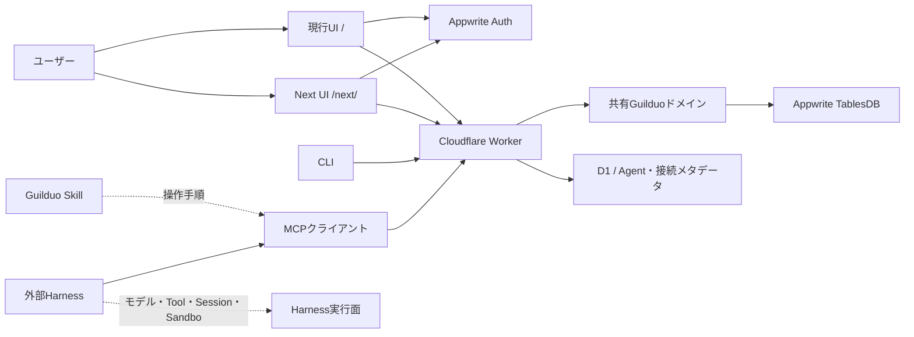

# Guilduo Project Specification

> 2026-10-12公開方針: 本体タグはSource Release、無料β配備は既存手動workflowで管理する。以下の署名・Live販売・Jev・連結計測ゲートは有料ローンチ候補の契約で、本体beta.9の公開で完了扱いしない。正本は[RELEASE_SETUP.md](RELEASE_SETUP.md)。

2026-10-10 追加方針：OpenAI / ChatGPT・Codex Windows・Grok Bot・Muse Codeをbeta.12候補で展開する。[導入・受入ガイド](docs/guilduo-next-hosts.jp.md)に構成と検証境界を記録する。OpenAIのhookなし提出ZIPとCodex通常版は別artifact。認証bridge・自動Agent登録・新規課金は追加しない。Grok／Muse実モデル・Human往復、各公開ディレクトリ掲載は配布検査とは別の工程とする。既存Claude・DSH・OpenCode・OpenClawの配布物は変更しない。

2026-10-10 最新方針：DSH・OpenCode・OpenClawの3プラグインはブラッシュアップ段階へ進み、公式日英Docsで導入を案内する。本人依頼でnpm `latest`を推奨配布タグとして採用し、DSHはbeta.17へ昇格、OpenCode／OpenClawは既存beta.16を維持。β版番号・公開済みarchive・既存互換IDは変更しない。検証範囲と残件は[完成度評価](docs/guilduo-plugins-completion.md)に残す。DSH beta.16の本人OAuth・基本読み書き・Desktop再起動再利用は履歴の証拠で、beta.17の全受入完了には読み替えない。以下は各時点の履歴。
2026-10-10 本人追確認：DSH beta.16を一区切りとして追加開発停止。公開OAuth・MCP読み書き・Desktop再起動後の保存認証再利用は本人確認済み。設定を開く前の復元完了は断定せず、設定なし新規／fork初回入力・Agent紐付け／Handoff・限定更新readback／競合・Human回答→再開は未受入。npm latest／beta=beta.16を維持し、source文書を公開状態に更新する。公開済みarchiveと捕捉済みREADMEは変更しない。[現行状況](docs/guilduo-dsh-status.md)。以下は各時点の履歴。

2026-10-10 14:15 JST 配布追記：DSH `@guilduo/dsh-oauth-poc` の `latest`／`beta` をともに `0.6.0-beta.16` と確認。凍結済み公開archiveは変更していない。[昇格票](.qa-artifacts/guilduo-dsh-lifetime-beta16/latest-promotion.json)。本人報告で公開OAuth・tool discovery・context読取を受入。認証保存後の再起動復元・別Desktop・Quest／Human往復は未受入。[範囲と残件](docs/guilduo-dsh-acceptance.md#2026-10-10-1409-jst-user-reported-public-oauth-acceptance)。以下のタグ／公開OAuth未確認の記述は各時点の履歴。

> **English summary:** Guilduo is a Human × AI Work Platform where humans and AI agents coordinate work in the same workspace. This document is the technical source of truth for product responsibilities, data contracts, authentication, synchronization, MCP boundaries, and release safety. Visual rules belong in [`DESIGN.md`](DESIGN.md); `/next/` visual differences belong in [`interaction-lab/DESIGN.md`](interaction-lab/DESIGN.md).

最終更新: 2026-10-02
追加候補: 2026-10-04 — 21工程の署名公開ガードと、既存匿名telemetryとは別の同意付き仮名化ローンチ計測。初期状態は無効で、本番受入・公開Goの代わりにはならない。
対象: `0.6.0-beta.9`候補 / REST・MCP `2.7.0` / Schema `7`
文書の位置づけ: アーキテクチャ、ドメイン、API、認証、安全性、運用の正本

## 1. 目的と境界

Guilduoは、現実の作業をQuestへ変換し、HumanとAI Agentが同じworkspaceで依頼、担当、実行、Handoff、Reviewを行うためのオープンな作戦盤である。

この文書が定義するもの:

- プロダクトの思想、用語、責務境界
- 正式公開URL、`/`、`/next/`、REST、MCP、CLI、Skillの関係
- Quest、報酬、MP、Battle、Quest Tree、Handoffの不変条件
- 認証、同期、公開情報、秘密情報の扱い
- UI変更、AI連携、リリース時に守る互換性ルール

この文書が定義しないもの:

- 詳細な視覚設計、色、タイポグラフィ、コンポーネントの外観
- 外部Provider OAuthの実装詳細
- Unity Battle Labやネイティブアプリの実装
- Agentの自動起動、汎用モデル呼び出し、Sandboxの実行（下記の公式Jev判断提案は限定された追加契約）
- API契約ファイルと同じ内容の重複定義

正式URLの早見表は[`docs/public-urls.md`](docs/public-urls.md)、host-based routingの契約は[`docs/appwrite-site-routing.md`](docs/appwrite-site-routing.md)を参照する。視覚設計は[`DESIGN.md`](DESIGN.md)、Next版の視覚差分は[`interaction-lab/DESIGN.md`](interaction-lab/DESIGN.md)を参照する。

視覚設計の成果物は、数値トークン[`design/TOKENS.json`](design/TOKENS.json)、部品[`design/COMPONENTS.md`](design/COMPONENTS.md)、画面[`design/SCREENS.md`](design/SCREENS.md)、アセット[`design/ASSET_MANIFEST.md`](design/ASSET_MANIFEST.md)を参照する。これらはQuestデータやAPI契約を変更しない。

## 2. プロダクトモデル

### 2.1 設計原則

1. **人間が目的と最終判断を持つ。** AIの提案、変更、レビューは確認可能にする。
2. **Questと報酬を分離する。** Quest完了でMPを得るが、Battleのコマンドとタイミングは人間が選ぶ。
3. **読む、プレビューする、実行する。** 書き込み、一括操作、Handoff、外部同期はdry-runを基本にする。
4. **削除より保管する。** 履歴、報酬、依存関係、外部リンクを保持する。
5. **人間とAIを同じパーティーに置く。** ユーザー、Astra、Agent、MCPクライアントを混同しない。
6. **データを閉じ込めない。** Web UI、REST、MCP、CLIは同じドメインルールを使う。

### 2.2 用語と責務

| 用語 | 意味 | 所有する責務 |
| --- | --- | --- |
| ユーザー | Appwriteで認証された本人 | 目的、最終判断、公開範囲、Agent設定 |
| Astra | ユーザーが選ぶ相棒キャラクター | 見た目、役職、MBTI、Battle上のキャラクター表現 |
| Agent | 作業を担当するAIの台帳エントリ | 表示名、Provider、許可スコープ、Handoff既定値 |
| MCPクライアント | ChatGPT、Codex、Claude等の接続元 | OAuth接続、利用スコープ、Agentへの紐付け |
| Party | 人間・Agentの作戦上の所属 | メンバー表示、担当Quest、レビュー関係 |
| Guilduo | データ・権限・作戦状態の管理面 | Quest、報酬、MP、Handoff、監査、同期 |
| Harness | モデルをツール付きAgentとして実行する外部面 | Model、Tool、Skill、Session、Sandbox、実行ループ |

## 3. システム構成

### 3.1 サーフェスの役割

| サーフェス | 役割 | 正式な位置づけ |
| --- | --- | --- |
| `https://app.guilduo.com/` | Guilduo / Relay ForgeのWeb App | 新規ユーザー向け正式入口・公開β |
| `/next/relay-forge/` | Relay Forgeのビルド後実装path | Appwrite Site内部path・互換入口。canonicalではない |
| `/interaction-lab/` | Interaction Labの開発・キャプチャ用source route | ローカル開発専用 |
| `/` | 現行UI、Appwrite同期、従来操作との互換 | 既存surface。公開導線はWeb Appへ集約 |
| `/next/` | Nextの互換・検証path | 新規ユーザー向けの正式入口ではない |
| `https://guilduo.com/` | Guilduo公式サイト / LP | canonical root |
| `https://guilduo.com/lp/en/` | 英語LP | 公式言語別入口 |
| `/lp/`・`/lp/en/` | Guilduoの説明、Product Proof、公開CTA | 日本語・英語の公式マーケティングSurface |
| `https://mcp.guilduo.com/mcp` | OAuth対応Remote HTTP MCP | AIクライアント向け正式endpoint |
| `https://api.guilduo.com/v1` | Appwrite API | SDK・WorkerのAPI endpoint |
| Appwrite Auth | Googleログインとユーザー識別 | 認証の基準 |
| Appwrite TablesDB | Quest・キャラクター・Battle状態 | ユーザー状態の保存先 |
| Appwrite Sites | Web/PWAとLPの静的配信 | 公開Webの配信面 |
| Cloudflare Worker | REST、OAuth、MCP、Webhook、拡張機能境界 | APIの実行面 |
| Cloudflare D1/KV | Agent、接続、プロフィール、短期OAuth状態 | Worker側メタデータ保存 |
| CLI | 人間・CI向けのREST/JSON操作 | MCPとは別の操作面 |
| Skill | AIに安全な操作順序を教える手順書 | MCPの利用ガイド |

`https://app.guilduo.com/`のrootは、同じAppwrite Siteの`/next/relay-forge/`へhost-based rewriteされる。ブラウザへ表示するcanonical URLはrootのままにし、内部pathを新規リンクへ露出させない。旧workers.dev URLとAppwrite generated domainは互換・検証・rollback用途に限定する。



### 3.2 データの正本

- Quest、キャラクター、Battle、報酬、イベントの業務ルールは共有ドメインを正本にする。
- APIの入力・出力は`api/openapi.json`、MCPのツール契約は`api/mcp-tools.json`を正本にする。
- `/`と`/next/`はAppwrite Authで本人を識別し、Worker RESTから本体スナップショットを取得する。ブラウザへAppwrite API Keyを渡さない。
- Workerは短命なAppwrite JWTを検証し、サーバー専用API KeyでTablesDBを読み書きする。`user_states`の行IDはAppwrite UIDとし、直接クライアント権限を付けない。
- 認証済みAppwriteユーザーのWorkspace初回読込では、本人の保存行とFirebase移行元が存在しない場合だけ、空のSchema 7状態を本人UIDで作成する。既存の読めない保存行・移行元、移行元の権限/通信エラーは初期化せずエラーにする。同時ログインの作成競合では保存済みの状態を読み直す。MCP/OAuthクライアントによる初期化は許可しない。
- `user_states`と`legacy_states`の`stateJson`は必須の`longtext`列とする。スナップショットはgzip＋Base64で保存し、旧形式のJSONも読み込める状態を維持する。旧string列を想定した60,000文字制限で通常の保存・移行を拒否しない。容量対策としてQuest、履歴、報酬、移行スナップショットを間引かず、revisionによる競合検知とトランザクションを維持する。
- Firebase移行データは`legacy_states`へ暗号学的メールハッシュをキーとして一時格納し、同じメールでの初回Appwriteログイン時に`user_states`へ一度だけ移管する。移行元は検証期間中だけロールバック用に保持する。
- Next版のローカル保存はゲスト利用、表示設定、前回スナップショットのためだけに使う。ログイン済みユーザーの本体データを別ユーザーへ表示しない。
- API、MCP、外部連携から受け取るJSONは未検証の外部入力として扱い、ドメイン境界で正規化する。
- GUIの遅延は保存確定までを測り、保存前の表示だけで成功と扱わない。認証付きREST/MCPにはリクエストごとに分離した処理時間を`Server-Timing`と`guilduo_request_timing`ログへ出力する。固定の処理名・経路分類、HTTP method/status、時間と回数のみを記録し、URL、クエリ、UID、Quest本文、認証情報、例外本文は含めない。並列・入れ子の区間は合計時間と重なるため、単純加算しない。

- Workerの実行配置は任意の`WORKER_PLACEMENT_REGION`（`provider:region`）でAppwriteの保存地域付近へ指定できる。未指定ならCloudflareの既定配置を維持する。配置調整はデータ移行ではなく、認証・保存先endpoint・トランザクション・revision照合を変更しない。対象環境の設定を空にして再配備すると元の配置へ戻せる。
- Relay Forgeのブラウザ計測は`guilduo_gui_timing`として固定の操作名と経過msのみをローカルconsoleへ出す。保存応答の検証・render後の描画機会までを測り、保存失敗・非表示タブ・破棄済み画面の成功値を記録しない。初期ロードはnavigation開始から、再接続は接続開始から測る。計測専用の外部送信は行わない。
- 本番の初期接続は、OAuth callbackのセッション交換後、Appwriteのアカウント検証と短命JWT発行を並列で開始する。JWTが先に返ってもアカウント検証の成功前には呼び出し元へ渡さない。検証失敗・サインアウト後の結果は破棄し、未検証のユーザー表示や認証検査の省略で高速化しない。
- 任意の `APPWRITE_PREPARED_TRANSACTIONS=true` はrevision batchが有効な場合だけ使う。認証済みWeb bootstrapとQuest作成・編集・完了の成功後に、空のAppwrite transactionをWorker環境ごとに最大1件準備する。TTL60秒の最初の30秒だけ利用し、IDを同期的に1回だけ取り出す。状態・ユーザーID・操作を事前保存せず、利用時に本人の最新状態を読み、従来のrevision照合とcommitを行う。準備待ちを他リクエストからawaitせず、未準備・期限切れは通常の開始処理へ戻す。定期補充やブラウザへのtransaction ID公開は行わない。

### 3.2.1 Optional launch measurement candidate (2026-10-04)

- `ANALYTICS_ENABLED=true` requires approved measurement configuration, separate data-policy approval and private collector/admin secrets. New owner consent REST routes are Human-only and unavailable through MCP. Legacy `/telemetry` retains its anonymous contract.
- Signup uses verified Appwrite account creation time; an existing account's first workspace is not a new signup. The approved Activation is a real Agent connection, saved Agent Quest assignment, saved Human response and saved Agent resumption for the same Quest/Agent. Payment precedes retention when it occurs; Checkout returns never prove payment.
- A bounded `launchAnalyticsOutbox` in the private snapshot is committed with the originating domain mutation. D1 ingestion is separate, idempotent and retried from the saved outbox on the next bootstrap; no business or paid inference operation is rerun. Client snapshot replacement preserves server-attested outbox state. Consent withdrawal invalidates the old random subject ID. Outbox overflow/unknown coverage must remain explicit; analytics failure must not fail Quest writes.
- LP capabilities expire after 15 minutes and can be claimed by one authenticated owner with explicit consent. First acquisition freezes at first App consent, including unknown; a post-signup visit never becomes acquisition. Origins, actual body bytes, quotas and finite campaigns are enforced. At 90 days subject lookup/ingestion stop immediately; scheduled D1 purge and persistent private-snapshot cleanup record retry backlog explicitly. Reports require a separate measurement administrator credential and return aggregates with mature cohort windows and unknown fees/costs as null.

### 3.3 プロフィール画像の正本と境界


- プロフィールの表示名、handle、bio、既定のキャラクター表示、現在の画像asset参照、`avatarVersion`はCloudflare D1の`social_profiles`を正本にする。Web UIとMCPの`get_my_profile` / `update_profile`は同じ行を読む・更新する。
- Appwrite Authのemailはアカウント情報として読み取り専用で表示する。プロフィールの公開情報やMCP出力へemailを混在させない。
- 画像バイトは既存の`AGENT_AVATARS` R2バインディング内でも`profiles/avatars/` prefixへ分離して保存する。R2 object keyはランダムasset IDとし、D1が現在のassetだけを参照する。
- `/v1/profile/avatar`のGETは認証済み本人に限定し、`v`が現在の`avatarVersion`と完全一致した場合だけ画像を返す。ブラウザはBearer付きfetchからBlob URLを作り、unmountまたはstale化時にrevokeする。永続公開URL、署名URLの無期限化、data URLのprofile保存は行わない。
- AvatarのPUT/DELETEはAppwrite Authまたは開発用認証のWeb mutationに限定し、PNG/JPEG/WebPの実バイト判定、300KB上限、ストリーミング上限をWorkerで再検証する。クライアントのリサイズはUX最適化であり、セキュリティ境界ではない。

## 4. ドメイン不変条件

### 4.0 双方向Relayの追加契約（2026-09-07）

- Questの`requester`は認証済みの作成主体（Human/登録Agentの安定IDと表示名）。既存Questは`null`のままにし、担当者や現在の接続から作成者を推測しない。汎用create/patch入力から作成者を指定・変更できない。
- `humanRequest`は独立したHuman確認Questのメタデータ。`sourceQuestId`で元のAgent作業へ結び、親子の集計・依存関係とは役割を分ける。`requestKey`によって同じ依頼の再送を冪等にする。`pending / deferred / answered`、確認対象、理由、既読時刻、回答・回答時刻・結果を保存する。
- Agentは自分の担当Questから確認を依頼できる。人の回答は本人のWeb認証を必要とし、Agentや通常のQuest更新で代筆・完了できない。確認先は外部の環境で、回答はテキスト。外部リンクを開くこと自体を確認・承認と判定しない。
- 作成・回答はdry-runと`expectedUpdatedAt`で現在状態を照合する。保留・再開・既読は確認Questのみを更新する。回答による確認Quest完了、Handoffのaccepted、元Questの完了はそれぞれ別の明示操作とし、親完了・報酬を連鎖させない。
- 同じrequestKeyの再送は元の依頼を返し、異なる内容への再利用は拒否する。回答済みの同一回答の再送は報酬を再付与しない。再確認は新しいrequestKeyの独立Questとして過去の回答を保持する。
- Human受信箱は回答開始前に取得した遅延一覧を回答後へ適用しない。dry-run中に画面を破棄した場合は実書込みへ進めず、保存済み回答・未対応件数を古い通信結果で戻さない。
- Schema 7へ任意フィールドを追加し、既存JSON/gzipを読み続ける。旧クライアントの全状態保存でも、サーバーが保持する依頼主・確認Questを消去/改変させない。API/MCPへ確認依頼の作成・一覧を追加し、回答はWeb用RESTから行う。既存のAgent/OAuth権限分離と保存容量修正を維持する。

### 4.1 Quest

- `planningState`と`lifecycleState`は別軸で管理する。
- 単発To Doの完了は`completed`を経由して`archived`へ正規化する。
- Habit、Daily、繰り返しTo Doは完了記録を残しつつ`active`へ戻る。
- 保管済みQuestは削除しない。復元は`active`へ戻し、履歴を保持する。
- 完了報酬、XP、Gem、MPは同一Questの同一回に一度だけ付与する。
- メモの有無はBattle対象判定に使わない。`habit`、`daily`、`todo`のみが対象である。
- `icon`は絵文字1つ（書記素1つ、16 UTF-16単位まで、文字・数字は不可）で、既定は空。`iconSource`は`auto`（辞書）/`user`（本人）/`agent`を記録する。MCPからの書き込みは常に`agent`になり、本人が選んだ絵文字（`user`）をAgentは置き換えられない（409 `icon_set_by_user`）。
- `proposal`はAgentが置いた「この時間にどうですか」（Agent ID・表示名・日付・時刻・5〜1440分・一言）で、1Questに1件。作成はMCPの`propose_quest_slot`（dry-run既定、実行は`expectedUpdatedAt`とAgentの紐付けが必須）だけで行う。それだけでは予定に入れない。本人が受けると日付と時刻を予定へ移し、受けても断っても`null`に戻す。通常のPATCHは`null`への消去だけを受け付ける。
- `reminders`は開始の何分前に知らせるか（0〜1440の整数を最大3つ、0は開始時刻）。無いときは本人の通知設定に従い、`[]`はこのQuestだけ知らせない。PATCHの`null`で設定に戻す。
- 通知（2026-10-25）はWeb Pushで届ける。VAPID鍵はGatewayがD1に1組だけ作って保持する（作り直すと全端末の購読が切れる）。端末・設定・送信待ちはD1（`push_subscriptions`・`notification_settings`・`notification_jobs`）に置く。購読先は既知のPushサービス（FCM・Mozilla・Apple・Windows）だけを受け付ける。`/v1/notifications/*`はWeb専用でOAuth（MCP）からは使えない。状態を書き込むたび、通知を有効にした人について今後48時間の自分の時刻つきTo Doのリマインドを組み直し、Agentの出来事（判断待ちになった・時間の提案・Agent担当の完了/停止）を送信待ちに積む。毎分のcronが期限の来たものを一度だけ送り、30分以上遅れたリマインドは捨てる。毎日1回（朝のまとめの時刻、オフなら03:00、本人のタイムゾーン）に状態を読み直し、まとめを送ってリマインドを補充する。410/404を返した端末は消す。

### 4.2 Quest Tree

- 親子関係へ参加できるのは`habit`、`daily`、`todo`である。
- Rewardは親子構造へ参加しない。
- 自己参照、存在しない親、循環、最大階層超過を拒否する。
- 子Quest完了で親Questを自動完了しない。
- 保管済み子Questは通常集計から除外する。

### 4.3 Handoff

- Handoff状態とQuestの完了状態は別管理する。
- 許可された状態遷移は`none → ready → working → review_required → accepted`を基本とし、`blocked`から復帰できる。
- 書き込みはdry-runを先に行い、実行時は`expectedState`または`expectedUpdatedAt`で競合を検知する。
- `review_required`はAgentから人間へ返却された状態であり、Quest完了を意味しない。

### 4.4 Battle

- Quest完了でMPを得て、Battleコマンドは別操作として実行する。
- Battle計算は共有のBattle Rulesを使い、Web UI、Worker、独立原型で結果を一致させる。
- MP不足、古いTurn、重複Command ID、終了済みBattleは拒否する。

## 5. 認証・同期・プライバシー

### 5.1 状態

認証と同期は、少なくとも次の状態を区別する。

```text
local
  -> auth-checking
  -> syncing
  -> synced
  -> stale
  -> error
  -> reconnect
```

- 同期中はQuest一覧を消さず、前回データがあれば読み取り専用で表示する。
- 同期中の完了、編集、保管、Agent変更は無効化する。
- 接続失敗時は原因を隠さず、「再接続する」とローカル利用の導線を表示する。
- ログアウト、別ユーザー切替、データ所有者変更時は前ユーザーのスナップショットを表示しない。

### 5.2 保存してはいけない情報

公開LP・Docs・Solutionsの同意済み匿名計測は既存POST /telemetry（schemaVersion 1）へpublic_page_view / app_cta_clickを追加する。page（kind）、source、language（status）とsurfaceは有限allowlistで検証し、URL・任意UTM・検索語・account IDを送らない。既存D1と90日保存を使い、登録・活性化と結合しない。JST日次集計は運営者の既存D1権限によるCLIで取得し、人数・実ユーザー数として扱わない。拒否・撤回時は待機中イベントと端末内の流入分類を破棄する。

ユーザー承認により公開ページへ専用GA4も追加する。GA4_MEASUREMENT_IDは公開設定としてrelease configへ注入し、同意後だけGoogle tagを読み込む。canonical URLのみを送りquery/hash/任意UTMを除去し、同じ有限流入区分を使う。広告同意・Google Signals・拡張自動計測・account ID連携は無効。Cookieは公開ホストに限定し最長90日、GA4のuser/event保存は2か月。撤回でga-disableを立て待機イベントとCookieを破棄する。Web App・認証・登録・Quest操作にはGA4を追加しない。

- Appwrite JWT、OAuthトークン、Appwrite API Key、Provider Secret
- モデルAPIキー、パスワード、外部実行URL
- Quest本文・メモ・UIDを匿名計測へ送信すること
- HarnessのSession履歴、Sandbox内部データ、モデル推論ログ

公開プロフィールは表示名、`@handle`、紹介文、アバター、レベルなどに限定する。Quest本文、メモ、認証情報は公開しない。

## 6. MCP、Skill、Harnessの境界

任意の公開ドメイン所有確認として、Workerは認証前の正確な `GET /.well-known/openai-apps-challenge` で `OPENAI_APPS_CHALLENGE_TOKEN` の値だけを `text/plain; charset=utf-8`・`Cache-Control: no-store` で返す。値を加工せず、未設定・空白のみ・制御文字を含む設定は公開404、GET以外は405とし、MCP/RESTの認証・契約は維持する。[公式提出仕様](https://developers.openai.com/plugins/deploy/submission#domain-verification-details)に従い運営者が発行値と指定hostを確認し、承認済み配備後にVerify Domainを実施する。本番は未設定で、ローカルテスト合格は所有確認・提出・公開の完了を意味しない。

### Shared MCP callers (2026-10-02)

- An OAuth connection can allow multiple owned active Registry Agents. Settings persists `allowedAgentIds` on the existing connection; migration `0011_shared_mcp_agents.sql` adds the membership column without renaming identifiers or changing Schema 7 state.
- Every MCP tool accepts optional `actingAgentId`. For a multi-Agent connection, execution requires it; discovery/control tools can inspect the connection without it. One-Agent calls retain their existing behavior. Identity is scoped to the current call, never written into a shared session or inferred from an OpenAI client name/User-Agent.
- The selected Agent must belong to the owner and the connection allowlist, be active, and use only the intersection of its policy and the original OAuth grant. Missing, invalid, unlisted, revoked and inactive identities fail closed. Human request and Quest requester metadata use that selected identity. Membership changes belong to authenticated Web Settings; `link_agent` cannot overwrite a shared connection.
- These are caller-declared identities within one authorized connection, not separate credentials or proof of which OpenAI product sent a call. Instructions must choose the known Agent ID and send it on every request. See [shared MCP setup](docs/shared-mcp-agents.md).

Guilduoは**作戦データ・権限・Handoffを管理するControl/Data Plane**、DeepSeek Harness、OpenClaw、Hermes等は**モデル・Tool・Skill・Session・Sandboxを実行するExecution Plane**として扱う。

### Guilduo側

- Remote MCP `/mcp`
- 検証用`/mcp-next`
- Guilduo Workflow Skill（Skill名: `guilduo-workflows`。2026-10-10明示承認の[移行例外](docs/guilduo-workflows-migration.md)）
- Agent RegistryとMCPクライアント紐付け
- Handoff状態、dry-run、競合検知
- OAuthスコープとユーザー分離

### Harness側

- モデル接続とモデルAPIキー
- Tool実行ループ、Skill読み込み、Session履歴
- Sandbox、承認ポリシー、サブエージェント実行

将来の接続は次の順序に固定する。

```text
Harness Client
  -> OAuth / Remote MCP
-> Guilduo Agent Context
  -> list quests / get brief
  -> dry-run assignment
  -> confirmed assignment
  -> working
  -> review_required
  -> accepted
```

DeepSeek HarnessはDeveloper Previewである。2026-10-06のマルチ環境計画では、共通MCPの隔離テスト通過後、固定版の独立bundle内だけにOAuth SDKアダプターを許可する。初回PoCはセッション内認証、共通Skill、既存ツールを用い、終了フック、永続認証、ルートアプリへの依存追加、モデル自動実行を含めない。実OAuth・更新・Human往復の受入前に一般配布済みとしない。[DeepSeek Harness公式リポジトリ](https://github.com/deepseek-ai/deepseek-harness)

2026-10-09のbeta.12／beta.13認証契約（履歴）：DSHの再起動後の認証復元と新betaのnpm公開を許可する。初回PoCの永続保存除外をこの工程に限って更新し、独立packageでWindows CurrentUser DPAPIによる保護とDSH native Credentialsの保存・原子的更新を用いる。保存対象は成功済みOAuth grant・client情報・discovery metadataのみ。未完了のstate／PKCE／callback、会話履歴、Quest本文は保存しない。native Sessionから確認した同一ownerだけへ復元し、forkへの継承を拒否する。明示切断とSession削除は保存grantも削除し、通常のplugin unload／再起動はRAMだけを解放する。実OAuth／Human受入とnpm公開は別に記録する。

DSH beta.13の接続不具合修正では、親pluginの`tools, skills, credentials, agents, sessions, sessionController`依存をexportと両bundleへ同じ内容で宣言する。Gateway子Contextのinjectを親へ流用しない。認証・保存の回帰検査はrootへの直接provideだけでなく、実Cordisの兄弟サービスの境界を通す。

2026-10-09 **DSH beta.14共有認証の実装・ローカル検証**：実装済み。[最終ローカル検査票](.qa-artifacts/guilduo-dsh-shared-beta14/validation.json)はPASS_LOCAL_RELEASE、75/75 package tests・2/2 root package tests・型／build／designが成功し、scoped reviewの残存P1/P2はない。[最終native票](.qa-artifacts/guilduo-dsh-shared-beta14/native-DhY3W3/evidence.json)は合成認証7/7 PASS、現行compiled hash一致で、元grant参照共有・再起動保持、初回組立前のawaited復元、native Credentialsのプロセス間refresh／切断、待機中取消・再接続競合・15秒上限を確認した。[最終UI／Settings／carrier集約票](.qa-artifacts/guilduo-dsh-shared-beta14/native-final-records-20261009-230829-212.json)は6並列Settings PASS・現行hash一致。README永久凍結後の再pack／[CLI beta.13→beta.14 upgrade等18検査](.qa-artifacts/guilduo-dsh-host/install-8gGvdY/evidence.json)はPASS、32ファイル全byte一致。最終tgz SHA-256は`43585b8d33ea5d2e4da8cde599d5302b60130834e9795f0f5f6eb1fe97b255ed`。2026-10-10 08:22 JSTにbeta.14をnpm公開・公開配布物を照合済み。beta tagはbeta.14、latestはbeta.10を維持し、公開tgzの全byte／SHA-256／registry integrityが検証済みarchiveと一致。[公開確認票](.qa-artifacts/guilduo-dsh-shared-beta14/publication.json)。beta.13以前の検査・公開は履歴として保持し、実Web／Desktop公開OAuth・Human往復は未受入。[受入条件と最終票](docs/guilduo-dsh-acceptance.md#2026-10-09-beta14-shared-plan-candidate)

- Windows・同じWindows user／`DSH_HOME`のWeb／Desktopで、新規の初回認証を共有する。通常会話・新規通常会話・root forkを許可し、subagent・runtime child・独立seeded会話をnative Session／Agent照合で拒否する。
- 旧exact-session grantは元会話の「設定 → Guilduo → 全会話で使う」を1回明示実行して共有へ移行する。認証済みSettings `guilduo/share` RPCだけを使い、暗黙移行しない。descriptorは元grantのSession ID／createdAtを参照し、tokenを複製しない。
- 共有切断は同じ`DSH_HOME`全体へ適用し、tombstoneで旧grantへのfallback・遅延復元を拒否する。共有後の元会話削除は共有を保持する。2026-10-10 beta.16候補は旧版の削除推定契約を訂正する：native `session/disposed`はメモリ離脱であり、`stat === undefined`は保存backendから不可視でも生じる。離脱時は完了済みgrantを削除せずRAMだけ解放する。DSH rc.2の公開契約に確実な会話削除通知がないため、未共有会話を削除すると保護grantが残り得るが、exact live ownerなしでは復元しない。削除前の明示切断、またはSDKの失効処理でgrantを除去する。未完了loginは離脱時に取消する。実際のbeta.14認証消失がこの経路だったかは未確定。
- `agent/created`で復元をawaitし、最初のモデル組立前に完了させる。会話選択も状態を自動取得する。認可済みgrantのdiscovery／refresh通信は15秒で打ち切り、失敗時も暗黙OAuth・推論を開始しない。明示再認証を必要とする状態は安全なstatusで返す。
- plugin寿命中catalogは1つで、会話ごとにtool定義を増やさない。Agent／Quest／OAuth scope・呼び出しごとの`actingAgentId`・standing permission・Free登録2Agentは不変。DPAPIは同じWindows userの保存保護であり、モデル・同一user／process内の信頼境界ではない。native Credentialsのプロセス間検証はDSH会話／履歴writerの同時実行安全性を証明しない。
- 更新は旧Web／Desktop profileを先に停止し、参加profileを更新してから再起動する。Desktopはnative plugin manager、Webは標準CLIを使う。配布はREADME確定後にpackし、隔離CLI upgrade／全byte照合を通してからnpm公開する。beta.14の正確な版・tag・公開tgz一致は2026-10-10に確認済みで、registryから導入できる。新archive／npm公開／実共有復元の成功は新しい証拠で別々に判定する。

DSHの次にOpenCodeの独立packageを追加する。OpenCodeは標準OAuth Remote MCPとSkill探索を再利用し、独自token bridgeを持たない。基本導入ではモデル継続を追加しない。終了時の任意補助は、継続更新を許可済みのQuest／actingAgentIdとexact session／canonical cwdへの明示opt-inに限定する。元の入力につき最大1回の確認で、直接MCP mutationや権限付与を行わない。Plan／読み取り専用／撤回／fork／中断は抑止し、追加モデル実行の費用を導入文書に記載する。

2026-10-09 OpenClaw追加契約：native MCP／OAuthと正本Workflow Skillを使う独立packageに限定する。独自bridge・custom UI・Labs依存・モデル自動実行・新規Agent登録は追加しない。対象host `2026.9.9`のnative SettingsのMCP／Accountsを使い、保存済み設定で接続名とURLを同じ値に揃える。無関係な設定を保持する。候補実装・テストと証拠文書は別担当が所有し、npm公開・公開OAuth成功とは扱わない。

2026-10-09の指示ではDSH標準CLI導入とnpm配布準備を最優先にする。既存bundle／tgzの`plugin --profile <name> add`・再導入・削除を先に検査し、本人login／callback接続と実OAuth・Human往復は別に受け入れる。npm版CLIは予約されたDesktop profileを管理できない。同日の本人によるnpm公開操作が`EPRIVATE`で停止したため、実験用PoCを`beta` tagで公開する候補から`private` fieldを削除して再packする。scope権限は公開時に確認する。実験用packageの公開を一般配布の実OAuth／Human受入完了としない。[導入手順](plugins/guilduo-dsh/README.md#install-with-the-standard-dsh-command)

### マルチ環境プラグイン契約（2026-10-06、Skill名の移行例外: 2026-10-10）

- 共通Skillの正本は`skills/guilduo-workflows/`。OpenAI/Grok、Claude、Muse、Piの配布物へ生成コピーし、AGPLを保持する。2026-10-10の明示承認により、旧ID維持契約のmigration exceptionはSkill `questforge-workflows` → `guilduo-workflows` と対応するSkillディレクトリ・呼び出し名だけに限定する。OAuth／MCP／package／plugin／storage IDは維持する。基盤manifest候補はbeta.11、DSH beta.16は2026-10-10 09:45 JSTにnpm公開・公開tgz照合済み（beta=beta.16、latest=beta.10）。OpenCode・OpenClaw beta.15は未公開で、新Skill名のみ配布する。旧配布物・旧名の検査証拠を保持し、beta.14のpending受入は閉じない。既存利用者は新版plugin更新→再起動、旧standalone Skillは利用者自身が削除／置換し、実設定を自動変更しない。[最小移行契約](docs/guilduo-workflows-migration.md)。Museの配布物には認証付きMCP宣言を含めない。
- Muse stable 1.4.3ではnative `.muse-plugin/plugin.json`を使用し、Skillと任意フックを一つのmanifestに宣言する。フックはイベント別の直接script argvで共通lifecycleを呼ぶ。Windowsで実行されないClaude互換のquoted `node -e`を移植しない。
- Claude互換配布の任意フック版は通常版と内容が異なるため、versionに`.hooks`を付けてキャッシュを区別する。切替時は実際のinstalled cacheを確認し、marketplaceの表示だけでhook有効化を判断しない。OpenAIの既存package名・生成先・登録ID・version規則は維持する。
- `/mcp`はJSON POSTを保持し、SSEを提供しないGET等は405。JSON-RPC envelope、ID、protocol、通知、宣言済み入力schemaを実行前に検証する。IDなしツール要求は変更を実行しない。
- 単独Agentの既存リンクが失効・無効なら、Agent ID省略時にも元のOAuth権限へ戻さない。未リンク旧クライアント、発見・接続復旧は区別する。OAuth resource/client bindingは発行・更新・認証時に検査し、既存の失効・並行refresh境界を維持する。
- OAuthの明示空scope/resource/client IDと重複した単値パラメーターは拒否する。token失効は対応する認可系列を先に無効化し、同じclientの新しい認可を失効させない。D1では認可要求・codeの消費を一度限りにし、利用履歴／失効／削除の競合でgrantを復活・上書きしない。KV単独のcross-isolate原子性は保証せず、共有βの認証競合受入はD1構成を必要条件とする。
- 追加のOAuth失効工程：client grantに認可系列がある場合、accessもrefreshと同じく最新の有効系列だけを許可する。再認可時は旧系列のaccessも無効になる。本人のDisconnect／履歴削除は、owner/clientを一方向hashで識別する失効境界を保持し、履歴消去・再認可で旧credentialを復活させない。後の明示再認可は最新系列だけを許可する。未登録の旧clientは、対応する失効境界がない場合に限り従来権限を保持する。単独tokenの系列失効と、本人の接続Disconnectを区別し、同じclientの新しい系列や別ownerを失効させない。この工程を未解決のままβ受入を通さない。
- 自発的同期は対象Quest/Agentへの継続許可が前提。毎回contextとQuestを読み、既存`update_quest`の限定patchと`expectedUpdatedAt`で更新し、読み戻す。未対応`dryRun`は拒否する。同じ結果は無更新、409・応答不明は再読取する。
- nextActionの180文字、handoff.noteの500文字上限はUnicodeコードポイント数とする。入力・正規化・読み戻しでサロゲートペアを分断せず、部分更新では未指定の既存noteを保持する。
- 任意フック/Extensionはリマインダーだけを担当する。トークン、会話履歴、直接ネットワーク書込みは扱わない。元の利用者入力につき最大1回、Plan Mode、read-only、未binding、許可撤回では同期しない。完了・Human承認・採点・報酬を同期から分離する。
- 実環境OAuth・Human往復・自発的同期、配布、公式提出、承認、Publishを独立した受入状態として記録する。Freeの登録Agent上限2をホスト数に応じて増やさない。詳細は`docs/guilduo-plugin-roadmap.md`へ集約する。

### OpenCode / OpenClaw extensions (2026-10-10)

The independent `@guilduo/opencode-plugin` and `@guilduo/openclaw-plugin` beta.16 candidates reuse native OAuth MCP and the canonical `guilduo-workflows` Skill. They add no API, token bridge, automatic Agent registration or root runtime dependency. Existing OAuth, MCP, package, plugin and storage identifiers remain unchanged.

OpenCode targets 1.18.32 / 1.18.35. Optional `phaseSync` is off by default and requires exact session, canonical cwd, Quest and known Agent binding. It permits at most one additional model reminder per original input; it never writes MCP directly or grants permission. Plan, read-only, forks, errors, compaction and revoked bindings suppress continuation. Reminder stopping and native inference cancellation are distinct operations.

OpenClaw targets 2026.9.9 with its recorded build commit, native Settings/Accounts and shared operator OAuth. A manifest declaration is not assumed to create saved MCP configuration. Existing aliases, disabled settings, filters and requester profiles are preserved. No additional lifecycle hook or custom UI is included; multi-person channel authorization remains outside this acceptance scope.

Progress updates require fresh Agent context and Quest reads, permitted narrow patches with `expectedUpdatedAt`, no-op detection and readback. Preview supported operations with `dryRun`; do not send an unsupported `dryRun` to `update_quest`. Human answers, Handoff acceptance, completion and rewards are separate actions. Free's registered-Agent limit remains two and does not increase with the number of hosts.

Windows native acceptance, public OAuth, guarded writes, Human answer/resumption, npm publication and official listing are separate recorded gates. Model-based checks use OpenCode Go `deepseek-v4.1-flash` without fallback. See [release status](docs/guilduo-host-extensions-status.md). The later user-authorized DSH beta.17 maintenance update addresses the legacy disconnect, restoration-deadline credential persistence and staging-link findings; published beta.16 remains immutable. Its [independent AI review](docs/guilduo-dsh-independent-review.md) and [completion assessment](docs/guilduo-plugins-completion.md) are AI evaluations rather than external human audits. Real-environment acceptance and publication remain separate gates.

## 7. 開発・変更・リリースルール

### Launch behavior and private caching (2026-10-02)

- Relay Forge Quest completion uses the existing score endpoint, preserving canonical rewards and archival rules. Handoff acceptance and Human-review completion remain separate from completion of the source Quest. The UI refreshes canonical Battle state after scoring and rejects older deferred snapshots; a missing session is never replaced with demo data.
- Editing a Quest preserves its planning state, scheduled date, unchanged assignee/handoff state and zero-minute estimate. Pending Quest and Agent writes cannot be submitted twice or cancelled by closing the editor; failures retain the draft.
- Quest PATCH and score accept optional `expectedUpdatedAt` in REST/MCP. The shared domain validates it against the latest transactional Quest before changing fields, events or rewards; mismatches return `409 quest_conflict`. Omission preserves existing client behavior. Every domain Quest mutation advances its timestamp, including writes within one clock tick. Relay Forge sends the version it displayed for editing and task actions, retains a conflicting draft and requires a fresh read before further actions. A second completion from a stale screen must not reopen a completed Quest.
- Relay Forge Quest completion uses the existing score endpoint, preserving canonical rewards and archival rules. Handoff acceptance and Human-review completion remain separate from completion of the source Quest. The UI refreshes canonical Battle state after scoring and rejects older deferred snapshots; a missing session is never replaced with demo data.
- Editing a Quest preserves its planning state, scheduled date, unchanged assignee/handoff state and zero-minute estimate. Pending Quest and Agent writes cannot be submitted twice or cancelled by closing the editor; failures retain the draft.
- An uncertain Quest create/edit result (lost response, server failure, or malformed success) holds resubmission. The editable draft stays available for copying; closing the editor refreshes the workspace through reads, without replaying the write. A confirmed 4xx refusal may be corrected and retried; stale versions require a new read. This does not add automatic merging or server-side creation idempotency.
- The Service Worker bypasses authenticated requests and private API/OAuth/MCP/telemetry paths. Static Privacy, Terms and LP navigation cannot replace the cached application shell. Old caches are invalidated by the v23 upgrade. This does not enable offline private data storage or register a new Service Worker for Relay Forge.
- `PRIVACY.md` and `TERMS.md` are the content sources for the static `/privacy/` and `/terms/` pages. Local output does not establish production availability, handling of deletion requests or legal acceptance. See `docs/launch-readiness.md`.
- The official service operator is Radon. Public bug reports go to the existing Guilduo GitHub Issues page; individual inquiries and account/data deletion requests go to `el2radon2official@gmail.com`. Self-hosted instances publish their own operator contact. Policy pages render the canonical documents' HTTPS and mailto links without requiring JavaScript. Publishing this contact does not establish legal review or completion of a deletion request.

- CI, manual Site deployment and tagged source release run the existing launch verifier against the built candidate in a local preview before publication. Privacy/Terms must contain their canonical content and Radon contact links without JavaScript; signed-out entry and demo return must pass in nine languages. A failed verifier stops publication. This local gate does not establish live OAuth, production policy delivery or legal/operational acceptance.
- From October 12, 2026, `v*` tags publish GitHub source releases only after matching package version, nonempty versioned notes and main ancestry. The tagged workflow uses isolated example configuration and performs no production migrations, deployments or secret updates. Site and Worker deployment remain separate manual workflows with their existing safety gates. GitHub Latest follows the current core beta and does not establish GA readiness. Independently versioned host extensions remain separate; unreconciled live Worker changes must be integrated before generic Worker deployment.
- CI, manual Site deployment and tagged release run the existing launch verifier against the built candidate in a local preview before publication. Privacy/Terms must contain their canonical content and Radon contact links without JavaScript; signed-out entry and demo return must pass in nine languages. A failed verifier stops deployment before remote migrations, uploads or activation. This local gate does not establish live OAuth, production policy delivery or legal/operational acceptance.

- Mobile Quest Flow uses a native modal dialog: background controls are excluded from accessibility and cannot receive focus. Explicit close, Escape, scrim dismissal, selection and desktop resize release modality; focus returns to the current trigger. Queued opening after disposal is ignored. Browser accessibility-tree evidence does not establish physical screen-reader acceptance.

### GUI latency repair (2026-09-07)

- Relay Forge boots from Quests, profile and Agent identity; auxiliary panels load after mount and expose loading/error/retry without replacing edited Quests.
- Appwrite JWT-shaped credentials go directly to Appwrite verification; opaque OAuth credentials retain the D1/KV and revocation path. Token shape never grants identity or scopes. Authentication refresh is forwarded and concurrent JWT issuance is shared.
- Relay Forge may prefetch the initial protected GET snapshot after Appwrite issues a session JWT, while account metadata verification is still pending. The Worker still verifies each request. No workspace is rendered and no mutation port is exposed until account verification succeeds and its UID matches the token's subject hint. Auth failure, logout, demo selection or an account mismatch discards the preparation. The subject hint is not an authentication decision. A stale token for a different verified account is discarded; deferred reads and subsequent mutations use the normal verified-account token provider.
- State mutations overlap the independent initial state read and transaction creation. Transactional revision recheck, staging, commit and conflict retry remain mandatory; failed attempts release the transaction. No state/Quest schema migration.
- Optional `APPWRITE_REVISION_BATCH=true` replaces the separate transactional read with an exact revision guard replayed atomically at commit: increment by 1 capped at expected+1, decrement by 1 floored at expected, then update the full state and expected+1 revision. Failed bounds roll back the whole batch. Only known bound/conflict responses retry; uncertain failures do not. This removes one HTTP round trip without removing the revision check. The flag is off by default and release generation validates true/false; production Worker and full-release workflows forward it. A live isolated-row probe verified rollback, overlapping competing commits, persistence and cleanup; CI median storage latency was 2820ms existing vs 1733ms batch, not a GUI acceptance result. Appwrite emits multiple final-state update events; integrations must handle duplicates. See `docs/atomic-revision-batch.md` for rollout evidence and rollback.
- CORS preflight reuse is bounded and origin-specific. Read requests have a deadline; writes are never automatically retried on timeout.
- Public Web App HTML uses the documented 120-second edge TTL plus 3600-second background-revalidation window (2026-09-21 policy in `docs/appwrite-site-routing.md`). Only public 200 HTML without Set-Cookie or private/no-store/no-cache directives qualifies; authenticated APIs and OAuth query URLs are excluded, and browser revalidation remains unchanged. Deployment must disable both HTML rules, verify DYNAMIC/BYPASS, retain previous hashed assets for 48 hours, validate the archive and start both old and new HTML after upload before re-enabling caching. Waiting 240 seconds alone does not establish safety for the 3720-second edge shell window.


- 共有ドメイン、API、MCP、Appwrite Schemaを変更する前に、この文書を更新する。
- API/MCPの契約変更は、互換性、dry-run、認証、ユーザー分離、既存クライアントへの影響を確認する。
- UIの見た目、コンポーネント、レイアウト、モーションを変更する場合は[`DESIGN.md`](DESIGN.md)を先に更新する。
- `/next/`のUI実験は[`interaction-lab/DESIGN.md`](interaction-lab/DESIGN.md)へ記録し、現行版へ自動昇格しない。
- 本番リリースは型チェック、テスト、ビルド、契約差分、Worker health、Appwrite Auth/TablesDB/Sites smoke testを通過してから行う。
- Siteのprevious-shell receipt v2はCloudflare JSDの既知のrequest Ray IDと10桁timestampだけを比較時に正規化する。保存probeの実bytes、その他のHTML/script、全asset hashと48時間retentionは維持し、v1は従来の完全一致で読み続ける。未知のscript形状や不正timestampは拒否する。
- Unity、外部OAuth、Agent自動実行は、この文書の更新なしに公開βへ戻さない。

## 8. 参照先

- [視覚設計正本](DESIGN.md)
- [Next版の視覚差分](interaction-lab/DESIGN.md)
- [共有型](types/questforge.ts)
- [共有ドメイン](server/questforge-domain.ts)
- [Guilduo Workflow Skill](skills/guilduo-workflows/SKILL.md)
- [API / MCP setup](API_MCP_SETUP.md)
- [公開βロードマップ](ROADMAP.md)

## Productivity workspace (2026-10-12)

- Relay Forge adds Board/List/Gantt views over the same Quests, independent Calendar and Notes destinations, and a shell-owned timer. Home is the public label of the existing `command` route. Network/Battle/Skills move to More; existing identifiers remain compatible.
- Private Notes and native TimeEntries are independent records stored in a D1-owned productivity workspace, separate from the Appwrite Quest snapshot. A single conditional revision write atomically changes the timer and its operation receipt; only one timer can run per owner. Missing D1 fails closed. No OAuth/MCP Agent access is added. The D1 migration introduction timestamp distinguishes existing synchronized users from subsequently created states; the preference is persisted on first access.
- Time source is an owner preference: native-first, Toggl-first, or separate. Unconfigured existing synchronized users retain Toggl-first; new users start native-first. Zero-valued records are present records. Existing `actualMinutes` semantics remain unchanged; selected totals are a separate projection. Native totals include historical manual minutes without manufacturing dated entries. Source totals are never blindly added together.
- Notes use explicit save, archive/restore and optional Quest links; unsaved navigation offers save/discard/cancel. Native timer start/switch/stop uses operation IDs and exact current-entry/version guards. A lost response is reconciled by reading, never by inventing success. Timer changes do not score Quests or modify Handoff.
- Record lists are paginated; ordinary writes are bounded at 900,000 serialized bytes, reserving 100,000 further bytes for stopping a timer. Oversized writes reject without truncation. Private export/import and confirmed owner deletion cover Notes, TimeEntries and preferences independently of legacy Quest exports. Restore is validated and revision guarded; a current running timer must be stopped before restore/deletion. A backup can restore at most one running timer. Deletion replaces old receipts with content-free tombstones to reject late pre-deletion operations. Operator account deletion includes the private D1 owner row.
- Dates remain local calendar dates, while time entries store UTC instants. Display and day splitting use the chosen local timezone, including DST; projected Habit/Daily occurrences do not create saved Quests. Publication still requires the existing release gates.
- Calendar Day/Week range selection snaps to 15 minutes. A mouse drag or touch long press only prepares a draft; users explicitly choose recorded work or a Quest schedule and save. Future work is scheduled rather than accepted as completed time. Local selected instants resolve in the report timezone; nonexistent DST wall times reject, repeated times choose the earlier offset. The common Quest editor exposes planned date/time/mode while preserving unchanged planning, assignee and Handoff fields.

## 9. English glossary

| 日本語 | English |
| --- | --- |
| 現行版 | current surface |
| Next版 | experimental beta surface |
| 相棒 | companion character |
| 担当Agent | assigned agent |
| 保管 | archive |
| Handoff | work handoff and review state |
| 作戦盤 | operations board |
| 実行面 | execution plane |
| 正本 | source of truth |

### Relay Forge workspace refresh (2026-10-02)

- Background and explicit reads preserve the current document and screen-region scroll positions, including movement during the request. Mobile pull-to-refresh at the top shares the existing read path, mutation guards, failure recovery and disposal rules; it never reloads the document or replays writes.

- The production Shell refreshes canonical REST snapshots every 30 seconds while visible and on focus, visibility return, online recovery, or explicit retry. It does not upload a whole client state. All Quest pages are read before applying a snapshot.
- Existing data stays visible during refresh. Shared write guards prevent mutation during refresh, offline state or a failed primary read. Editors and active writes postpone automatic refresh; a detached mount never applies a late response. Selection, drafts, focus and cached authenticated avatar URLs are retained.
- Failed primary reads keep the previous snapshot and offer retry. Optional panel failures retain previous panel data and stay explicit. Recovery uses reads only and never repeats an uncertain write.
- A successful Appwrite account response must contain a nonblank string account ID. Invalid identity metadata is an authentication connection error: it clears cached identity/JWT and cannot release prepared workspace data. Speculative token subjects remain matching hints, never identity authority.
- Self and Human assignments represent their actual single holder in Command; they do not imply an Agent handoff chain. Other Human IDs and saved names remain distinct from the signed-in account, without borrowing its authenticated avatar. Not-started and completed holders retain their real state.

- Public policy output wraps the canonical content in Cloudflare email_off comments so the deliberately published operator email remains readable and mailto links work without JavaScript after edge processing. Local build checks preserve both comments; production checks validate the actual edge-delivered links. This exception is limited to public policy content.
### Paid-launch compatibility and approval boundary (2026-10-03)

[BILLING_SPEC](BILLING_SPEC.md)を商品仕様の正本とする。Freeは登録2Agent：active+disabledを数えarchivedは除外、Proの登録総数は無制限。OAuth接続数/共有connection membership上限とは分離する。超過/降格でAgentやQuestを削除せず本人のselect2を保持し、共通Web/REST/MCP境界で非選択Agent実行と登録迂回を拒否する。

Guilduo側判断AIの限定追加として公式TypeSafe Jevのテキスト有限候補提案を認める。Agent実行・完了・認可はモデルに委ねず、許可候補、confidence、Quest版を確認して本人が既存担当/Handoff経路へ適用する。Luna/OpenRouter/画像/自由文生成は今回対象外。通常CRUD/Quest/HandoffはAI Credit消費0。

署名付きStripe通知と決済側再照合を正本にD1の利用権/台帳を更新し、戻り先だけでPro化しない。`BILLING_ENABLED=false`/`BILLING_MODE=test`/`JEV_ENABLED=false`を既定にする。金額/付与量/割引/紹介/税/返金は原価・運営判断待ち；公開販売は承認済み設定とLive受入まで不可。Server専用変数/秘密鍵をブラウザへ渡さない。Stripe Testキー設定/実接続・受入はひろなおの保留解除指示で親担当が再開。商品/運営条件・本番Goは未承認、Live不可。実Test接続や既存Test価格を販売承認へ読み替えない。

Release順は**検査→署名対象の追加D1→Worker+health/MCP→expected Worker/source照合→Site+smoke→署名付き全先行LA/BM再検査→Release**。canonical origins/Web PlatformsはWorker配備前に用意する。手動/タグworkflowは同一production lock。cache/旧asset保持契約を変えない。[運用証拠形式](docs/launch-operations.md)のSHA/tree/hash/signatureを検査し、通常CIのPASSを実機/実接続受入へ読み替えない。LA-08事前Goと実Release、LA-09実投稿、LA-10実経過72時間を分離する。
