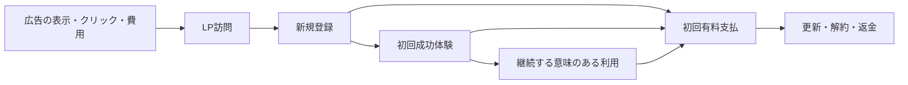

# Guilduo 有料ローンチ・計測・広告開始ロードマップ

更新: 2026-10-08 / 状態: **初回導線・市場検証・段階告知の戦略を追記。既存21工程の候補実装・検証記録は保持。価格／Credit基本条件・測定契約は採用済み。実利用・商用予算の受入・販売条件・本番Go・告知後72時間の受入は残る。**

本人追加判断: 商用Jev予算を日本時間10月6日〜11月5日、総額USD5で採用。Live商用候補だけへ割当、Testへ重複配分しない。開始／終了境界とmode分離を既存parserで検査済み。商用実受入・販売／運営条件・Live／公開Goは残る。本人は実機準備後に参加する。

## 2026-10-08の監査反映：初回往復と市場検証を優先する

出典は、ひろなおが提示した「3プロジェクト徹底監査・統合ローンチ戦略」（調査基準日2026-10-08）。Guilduoの現状監査・完全戦略・12週間計画・共通施策の該当部分だけを抽出した。ここで追加するものは実行計画で、実施済みの証拠ではない。競合の機能・価格、GitHubのStar／Fork／Homepage／Topicsは資料の調査記述で、今回外部へ再照会していない。他製品の施策や製品間の時間配分は含めない。

資料の「MCP 54ツール」は現ローカル契約`api/mcp-tools.json`の56ツールと差がある。rootアプリ候補は`package.json`の`0.6.0-beta.8`、プラグイン候補のbeta.10は別の版。LA-01で対象ソース・契約・配布物を固定して配備版を決め、資料の版指定をそのまま配備指示にしない。

### 対象利用者と伝える価値（LA-11／07）

- 第一対象は承認済みの「外部AIを使う個人開発者」。その中でもCodex／ChatGPT／Claude等を2つ以上使い、複数プロジェクトの依頼・成果・修正指示がチャットへ散らばる人を募集仮説にする。
- 第二対象は2〜10人のAIを活用する小規模チーム。共有Workspace・管理者・監査機能は個人利用の需要確認後へ送る。一般ToDo、大企業、Asana全面代替は初期の対象に広げない。
- カテゴリ候補は **Human–AI Work Control Layer／人とAIの仕事をつなぐコントロールレイヤー**。Hero候補は「人とAIの仕事を、依頼から承認まで一つに。」、Subcopy候補は「複数のAIと人間の間で、依頼・証拠・判断・引き継ぎを追跡するオープンなワークスペース。」。
- 「人もAIも、依頼主。人もAIも、担当者。」はブランド思想の補足へ。英語候補は「The control plane for work between humans and AI agents.」。実受入範囲に合わせLA-07で文案を確定し、ブランド正本や公開LPはこの計画だけで変更しない。
- 差別化仮説は**複数クライアントを横断するHandoff・Evidence・Decisionの継続**。単一製品内のAgent管理、LLM推論量、機能数を主な訴求にしない。外部Agentの自動起動・自動継続は約束しない。

### 最初の一本と変更範囲（LA-02〜05／07／15）

体験は **Quest作成→Codexへ依頼→成果のEvidence→Human確認→承認／修正依頼→Agent再開→元Quest完了・履歴** の一本に絞る。Human確認Questの回答、Handoff accepted、元Quest完了は既存の別操作を維持する。承認済みActivationは同じQuest／Agentの「実接続→保存された依頼→Human回答→Agent再開」で、元Quest完了までのE2Eは追加の品質確認として記録する。

| 優先 | 既存工程へ追加する仕事 | 完了条件 |
| --- | --- | --- |
| P0 | 対象版を固定し、署名付き配備Goの範囲で候補を用意→実Google／PC⇄Pixel 9／TalkBack→実Codex往復 | LA-01〜05の実証拠。別アカウント隔離、競合・通信断・再読込・重複拒否も確認 |
| P0 | 新機能・追加言語・追加ホスト拡張を一時Freezeし、初回導線と接続失敗を改善 | データ・権限・課金・アクセシビリティ修正と既存21工程の不足解消は継続。既存プラグイン受入は[別台帳](guilduo-plugin-roadmap.md)を保持 |
| P0 | Home／Quests／Party／Connections中心、Network／Battle／Skills／GuildはAdvanced／Moreへ | 既存画面・部品を再利用。機能・保存データ・既存深いリンクを保持し、キーボード／TalkBackで全画面へ到達できる。UI実装前に設計正本を更新 |
| P0 | LP→ログイン不要Demo→Google→Codex接続→サンプルQuest→証拠確認／判断→再開 | Demoを実接続と区別。登録からActivationまでTTV中央値15分以内を目標にし、離脱・手動支援・最終完了時間も記録 |
| P1 | 一般MCP／Codex導入を先に完成し、ChatGPT、Claude／OpenClaw等へ拡張 | 実接続済み範囲だけ案内。ChatGPTのプラン／モバイル／書込み等の制約は現行公式資料で確認し、唯一の入口にしない。LA-03の既存共有MCP受入は保持 |

### Docs・配布への信頼・実演（LA-07／09）

既存の公式`/docs/`を使い、`docs.guilduo.com`は予約のままにする。原稿のURL案は新設・公開済みの表明ではなく、以下の役割を既存ページと照合する候補として扱う。

| 役割 | 再利用するもの／不足時の追加候補 | 優先 |
| --- | --- | --- |
| 初回導入とCodex往復 | 既存`/docs/getting-started/`、`/docs/codex/`、`/docs/mcp-connection/`、`/docs/human-relay/`を一本の実演へつなぐ | 招待β前 |
| Quest／Handoff／Evidence／Decision | 既存`/docs/quests/`・`/docs/agents/`・Human Relayを補う。概念ページ増設より初回手順で説明 | 招待β前 |
| クライアント別接続 | 既存Claudeガイドを保持。ChatGPT／OpenClawは実受入後に不足分だけ追加 | 対応拡張時 |
| 用途と比較 | AI coding reviewを最初の用途記事にする。multi-agent project management／human-in-the-loop、Notion／ClickUp／Linear比較は需要と一次資料を確認後 | P1／P2 |
| 信頼・運営 | 既存Privacy／Terms／Security／問い合わせを整合。Changelog／Statusの公開形態と障害更新責任者を決める | 公開前 |

GitHubのdescription・Homepage・Topics・Social Previewを点検し、Homepageは公式サイトへ向ける。Topics候補は`ai-agents`、`mcp`、`human-in-the-loop`、`agent-orchestration`、`multi-agent`、`task-management`、`ai-workflow`、`open-source`。設定・外部公開の完了は実結果で記録する。

45秒Demoと3〜5分の実演で依頼→証拠→判断→修正→再開を見せる。実装・試験・失敗記録→短文／動画→技術記事→Docs／FAQの順に再利用し、独自の証拠・正確な構造化データ・通常のSEOを優先する。競合比較は用途と境界を公平に説明する。Founderと製品の発信は役割を分け、Guilduo利用者へ無関係な製品を継続宣伝しない。

### Design Partnerと市場検証の判断（LA-11／14／15）

候補15人を整理し、最初の5人から始め、計10人以上を個別オンボーディングする。募集・DM・メール・画面共有依頼の送信は本人の指示後。初回接続、TTV、詰まり、手動支援、翌週利用、既存手段との比較、支払いたい理由／払わない理由を記録する。最頻出の上位3件へ絞り、説明追加だけでなく製品導線を修正して再測定する。

以下は**広い公開βの募集・告知へ進む市場検証の初期判断ライン**として採用する計画値。業界平均や達成実績ではない。既存21工程・署名manifest・LA-08の技術／商品公開Goとは別に判定し、D7をRelease workflowの追加ゲートにしない。無料β先行やBM工程の先送りは既存の商品判断と計画改訂が必要。

| 観測対象 | 初期判断ライン | 記録方法 |
| --- | --- | --- |
| 実ユーザーE2E | 10人以上 | 運営者・fixtureを除き、依頼からHuman判断・再開・元Quest完了まで保存で照合 |
| Activation | 60%以上 | 承認済み定義と7日窓の成熟分母。人数、同意率、欠測、支援有無を併記 |
| TTV | 成功者の中央値15分以下 | 登録からActivationまで。未達・離脱者を隠さず、最終完了時間は別記録 |
| 翌週再利用 | Activated UserのD7が30%以上 | 初回Activationから[168h,192h)の有意味操作。登録起点D7と別表・別分母にし、窓が閉じるまでpending |
| 重大品質 | データ消失・権限漏れ・重複実行の重大バグ0 | LA-02〜06／16の実証拠と未解決一覧 |
| 課金意思 | 最低3人 | 通常価格・提供価値・条件を示した回答。実決済・有料需要の証明とは区別 |

North Star候補は **Weekly Reviewed Human↔Agent Handoffs**。日本時間の月曜00:00〜翌月曜00:00に、実AgentのEvidenceがありHuman判断が保存されたレビュー往復を数える。対象Quest／Agent／レビュー依頼を照合し、再送は重複計上しない。修正後の新しいレビュー往復は別依頼として記録し、元Quest完了数や登録数と分ける。正式な集計定義とfixtureはLA-12／14の追加作業で、現レポートで算出済みとは扱わない。

資料のイベント案`signup_completed`、`agent_connected`、`quest_created`、`handoff_sent`、`evidence_received`、`decision_recorded`、`revision_requested`、`quest_completed`、`returned_day_7`、`upgrade_started`、`payment_completed`は、既存保存イベント・支払投影・集計への対応付け要件として保持する。現実装の`quest_requested`／`human_feedback_saved`／`agent_resumed`／`activation_completed`／`meaningful_activity`を改名せず、D7は成熟窓の集計、paymentは検証済みinvoiceから求める。不足するEvidence／Decision／Revision／最終完了・週次レビュー集計だけを、同意・保持・欠測・重複排除を維持して追加検討する。クリックだけで保存成功を認定しない。

### 料金と広告の扱い（BM-01〜05／AD-01〜02）

承認済みのFree登録2Agent、Pro登録無制限、月USD10／年USD96、月1,000 Credits・30日、紹介100 Credits、金額割引なしを維持。通常MCP CRUD／Quest／Handoffは0 Credit。資料の「Free 2 Linked Agents」は登録上限へ読み替え、接続数と混同しない。高度履歴・検索・自動化・Exportを現Proの提供済み機能へ加えない。Teamは需要確認後へ送り、推論販売やAI無制限を約束しない。

Founding User「3か月USD5」や50%割引は金額割引なしと異なるため未採用。まず通常価格への支払意思3人を確認する。商用Jevの日本時間10月6日〜11月5日総額USD5は承認済みで、広告・販売・Live有効化の予算／Goとは別。販売主体・年齢に応じた法定代理人・Stripe Live資格・税／規約・費用記録・必要な校則上の収益活動確認はBM-01／05とLA-06で販売前に整理する。

広告は当面0円。AD-01開始判断にActivation30人以上、成熟した翌週利用10人以上、支払意思3人以上、実Live課金2人以上を目標として追加する。広告前の2人は自然流入／招待から確認し、Testや運営者の少額動作検証を顧客数にしない。Google Search／Redditの有限試行を先に検討し、Xの広い興味関心広告は後段。人数を満たしても既存のLA-10／14／15／16・BM-05、予算・期間・文案・停止条件・広告Goが揃うまで出稿しない。

### 実行時期の目安と停止・修正判断

12週間は実受入・本人判断・参加者・観測窓が揃った時点を起点にする**相対的な目安**。2026-10-08からの確定公開日や自動実行予定にはしない。依存条件を満たせば前倒しできるが、実D7／72時間の経過は短縮しない。

| 時期 | Guilduoの仕事 | 次へ渡すもの |
| --- | --- | --- |
| Week 1 | 機能Freeze、対象版／実Google同期／実Codex E2E、4画面導線、計測不足の照合、GitHub入口の整備 | 技術受入証拠と招待βの初回手順 |
| Week 2〜3 | 候補15人、個別10人以上、上位3件の修正、45秒Demo、Getting started／Codex／AI coding reviewの資料 | TTV・離脱・支援・課金意思と成熟待ちコホート |
| Week 4 | 市場検証ラインと既存21工程を別々にGo／修正／pending判定 | 未達原因と再試行範囲。期日だけで公開しない |
| Week 5〜6 | 承認済み公開・段階告知とLA-10の実72時間。初週は新機能を増やさない | 接続失敗、初回完走、問い合わせ、再利用、実課金の記録 |
| Week 7〜8 | 継続の強い用途へLPを寄せ初期導線を整理。販売受入後に少人数へ通常Proを案内 | 継続・払わない理由・実原価。割引は自動導入しない |
| Week 9〜10 | 再利用・請求／返金・サポートを継続観測 | 成熟D7／D30と欠測、用途別の結果 |
| Week 11〜12 | 再利用・課金・実原価・運営能力から次の投資を判断 | 拡大／用途の絞込み／新機能停止、次の有限予算と観測期間 |

告知は承認済みRelease後を起点に、Day 1 X／GitHub、Day 2 Product Hunt、Day 3 Show HN、Day 4〜6コミュニティ別Reddit、Day 7 YouTube実演を候補とする。媒体規約・文案・対応能力を確認し、各投稿は本人の公開指示後。Product Huntで直接Upvote依頼をしない。LA-09の実告知から72時間を測り、Day 7までの施策とは区別する。

30人以上の個別導入コホートが成熟してもActivation30%未満、翌週再利用20%未満、「今の方法で困っていない」が多数、または支払意思がほぼ0なら、新機能を止めて**AI coding review／Agent handoff**へ用途をさらに絞る。停止判断の再利用率は個別導入開始から[168h,192h)の有意味操作を、Activation未達も含む成熟した全個別導入者を分母にして求める。上記の公開募集目標に使うActivation起点D7とは別集計にする。条件ごとに人数・欠測・支援・価格提示を確認し、一つでも該当すれば原因レビューを行う。観測不足はpending。一般ToDo化、Enterprise化、追加言語、Retention確認前の広告で解決しない。

各試行は **客観分析→上位課題→最小修正→関連検査・実再受入→独立レビュー→本計画更新** を繰り返す。文書更新・ローカルPASS・外部Quest登録・配備・募集／告知・Live販売・広告を別々に記録する。今回の追記は署名manifestのschema／planVersion／21ゲートを変更しない。コードや商品条件を変えるときは候補と証拠を新たに固定し、過去snapshotへ上書きしない。

## 2026-10-06の改善サイクル

| 対象 | 客観確認で見つかった不足 | 実装・再検証 |
| --- | --- | --- |
| LA-01 | Worker／Releaseがshallow checkoutのため、署名済み基準SHAとmigration差分を比較できない | full historyを取得。ゲート回帰検査で修正前の失敗／修正後成功を確認 |
| LA-01 | 未知ゲート判定がprototype由来の`constructor`を受け入れる | own propertyだけを認め、署名済み不明ゲートの拒否を検査 |
| LA-06／16 | R2復元検査が保存metadataを読み戻さず固定値を使い、別ownerの計測／業務保持の検査が不足 | 保存manifestから復元しkey／content-type／bytesの破損を拒否。任意計測削除と金融記録／別owner保持を検査 |
| LA-13／14 | 公開用計測検査がWindowsのC: alias／実D: root差でbuild失敗 | 既存ビルドと同じ`realpathSync`へ統一し、source／built各31成功 |
| LA-01／13／16 | CIに課金／別同意計測／運用drillの継続検査が不足 | 既存検査とBattle／ConnectionsをCIへ接続。9検査への失敗注入で後続停止を確認。リモートCIは未実行 |
| LA-05 | 未認証入口も564.05kBのShell／production実装を取得 | native dynamic import候補を実装。統合レビューでobserverと読込世代の混同を発見し追加修正。最終build入口215.43kB、入口12条件成功。未認証Shell／production取得0を確認。本番性能は未受入 |
| BM-03 | Credit予約後・Provider送信前の中断が管理精算で409になり予約を解放できない | 独立レビューでP1。未送信を台帳照合＋CASで確定し予約／元の期間の予算を回復。実workerd D1 bindingの競合／再中断を含む関連44条件成功。送信結果不明は自動返却しない |
| LA-13 | 同意撤回・snapshot清掃後に進行中のQuest保存が古い計測IDを復活させる | 各mutation試行で同意を再取得し、失効outboxを永続清掃キューへ再登録。停止中のbootstrapも回収。修正前失敗／修正後成功、独立再レビューで当該指摘closed |
| BM-03 | 予算確保後・Credit予約未成立の中断でも予算が保持され続ける | 追加P2。予約batchをdecision CASで保護し、予約・台帳履歴の不存在を確定した場合は元予算だけ解放。実D1競合を含む関連48件／統合630件成功 |
| LA-13 | 古い清掃DELETEと同clockの再queueの並行回帰が不足 | DELETE直前停止・遅延保存・新削除中断・古いDELETE再開でもretryを保持。旧条件で失敗／修正後18件成功 |
| LA-14 | Test請求がLive subjectへ投影される | 共通投影境界で既存`billingMode`と計測environmentを照合。Test／Live両方向の混入拒否と一致時の成功を検査 |

今日中の候補品質改善と、本人参加・外部環境・実時間が必要な受入を分ける。実Google／物理Pixel 9／実MCP・Human往復、商用予算の実受入・販売資格・正式Go、署名SHAとリモートCI、Release／告知／72時間の実受入をローカルPASSで代用しない。具体的結果は[確認記録](launch-readiness.md)へ追記する。工程や合格条件の意味は変更しておらず、署名manifestの`planVersion: 2026-10-04`を維持する。

Guilduoの現行公開βを、実利用・商品受入・ファネル計測・正式リリース・告知・初期安定確認まで進める。既存LA-01〜10／BM-01〜05にLA-11〜16を追加し、**21工程**で管理する。広告の少額試行AD-01と拡大AD-02は、その後の別マイルストーンとする。広告費を使うことを正式ローンチの完了条件にはしない。

過去候補の本番配備と、今回の未配備の課金・Jev候補を区別する。既存LP-R01〜R08を作り直さず、LP-R07と告知Questを再利用する。**2026-10-04に21工程ガード、別同意のファネル計測、商用Jev予算分離とローカル復元リハーサルを実装。** 新工程の実利用受入・外部Quest登録・外部設定・配備・広告・監視開始は未実施。実装候補と実受入を区別する。

親Quest: `quest-ba3ec85b-2a82-45c5-bef2-cb57c0bc5826` — [LAUNCH] Guilduo公開βのローンチを完了する

## ローンチ完了の定義

次のすべてを満たして初めて親Questを完了する。

1. 対象ソース・main・タグ・Site／Worker／D1・API契約の対応を記録し、対象SHAのCIと公開検査が成功している。
2. 実Google認証、PC⇄物理Pixel 9の同期、共有MCP、実Human往復、アクセシビリティ、性能を受け入れた証拠がある。
3. データ損失・権限漏れ・ログイン不能・主要操作停止を起こす未解決不具合が0件。軽微な制限には影響・回避策・担当・次の行動がある。
4. 問い合わせ・本人確認・削除依頼・バックアップ／隔離復元・障害復旧を運用でき、公式入口・手順・ブランド表示が実装と一致している。
5. BM-01〜05で有料価値・料金・決済・利用権・Credit・紹介・請求画面を受け入れ、正式タグ／GitHub Releaseと承認済みの告知を公開し、URL・SHA・配備IDを記録している。無料β先行は明示決定と計画改訂を必要とし、課金作業の完了に読み替えない。
6. 告知後72時間の確認を終え、重大障害が残らず、残件を公開後backlogへ引き継ぎ、運営者の最終確認がある。
7. LA-11〜16で対象利用者・成功体験・計測定義を揃え、正式LP／App／MCP／Live決済をまたぐファネルの採取・重複排除・集計・同意撤回を受け入れている。継続率の測定手段は必要だが、未成熟なD7/D30コホートの成功率を72時間で確定しない。

72時間は今回の計画で定めた初期確認区間であり、長期の可用性保証ではない。ブラウザ幅の試験を実機受入に、子Questの進捗率を全体受入に読み替えない。

### 三つの判定を分ける

| 判定 | 必要なもの | 判定に使わないもの |
| --- | --- | --- |
| 正式ローンチ | 商品・安全性・実利用・復旧・計測の受入、対象版のCI、公開Go、Release／告知、72時間確認 | 広告出稿、架空のCVR目標、未成熟のD7/D30、推計LTVの黒字 |
| 少額広告開始 AD-01 | ローンチ受入、少人数の初見試行、広告→初回支払の計測検証、上限付きの予算・停止条件・掲載内容の承認 | Stripe Test成功だけ、アクセス数だけ、予算未指定の出稿 |
| 広告拡大 AD-02 | 成熟した継続／支払コホート、返金・実原価・実広告費、追加負荷とサポート能力、次の予算範囲の判断 | 72時間のhealthだけ、初月年払の入金を月次利益と扱うこと |

### 分析で見つかった不足と扱い

| 項目 | 確認できた状態・参照元 | 不足／今回の計画への反映 |
| --- | --- | --- |
| 広告→LP→App | LPの別同意・有限campaign・15分capability・Appの本人同意を候補へ実装 | 正式origin／実認証／実広告データの受入は未実施。セッションを人数と扱わない |
| 匿名計測 | `telemetry.ts`と`migrations/0006_telemetry.sql`には同意付きの性能・同期等のイベントと90日保持がある。イベントごとのUUIDは利用者IDではない | 既存データから継続率や広告別CVRは復元できない。既存の匿名契約を維持し、連結計測を別契約で設計 |
| 正式App | 本人Settings同意と、保存と同時に確定する計測outboxを候補へ実装 | 9言語・公開用ビルドの隔離検査済み。実端末・実Google／MCP受入は別 |
| 支払 | run9のHosted月／年・Portal・Webhook・更新／失敗／解約／返金等14項目PASS。Test・100 Credits／周期・紹介25の結果 | 決済の動作証拠。Live初回支払の分析、商品承認、広告への帰属とは別 |
| Jevと原価 | 固定モデルの6件合成評価がある。実請求未照合。現実装は合成評価と通常判断で最大USD1の共通D1予算を共有 | BM-01／03で商用予算分離・上限・停止時の扱いを先に解決。月1,000 Credits案の提供能力は未保証 |
| 利用者への価値 | 実Human往復、外部クライアント、実Google／Pixel 9、本番性能は未受入 | LA-11／15と既存LA-02〜05を接続。デモやAgent登録だけを成功体験にしない |
| 運用／販売資格 | 規約・連絡先・手順はある。受付、削除、隔離復元、Live加盟店／後見人、税・販売者表示は未受入 | LA-06、BM-01／05、LA-16をP0に維持。窓口掲載やTest API 200を運用完成にしない |
| 公開ガード | schemaVersion 2・planVersion 2026-10-04・全21ゲートを認識。旧manifestと広告ゲート混入を拒否 | ローカル検査済み。対象SHA／証拠／署名付き公開Goが揃うまで本番公開不可 |

コードと保存記録を2026-10-04の計画更新で照合した。前の計測監査では公開LP／AppのHTTP 200と配信entryも確認したが、本番DB、広告アカウント、実ユーザーの人数・継続率・売上は調査していない。具体的な実施結果は[readiness](launch-readiness.md)を正本とする。

## 出発点と正本

- 2026-10-03の配備・公開検査: [ローンチ確認記録](launch-readiness.md)。配備ソース `dbdb112`、Site Actions `37024673402`。453テストと公開版検査はこの候補の記録であり、将来の修正版へ自動継承しない。
- 同日にGitHub APIで `ELRdn/Guilduo` の **PUBLIC** を確認。告知Questの旧PRIVATE記録を訂正した。X投稿の完了は確認していない。
- [PROJECT_SPEC](../PROJECT_SPEC.md)、[公開URL](public-urls.md)、[ブランドゲート](brand-rollout.md)、[リリース手順](../RELEASE_SETUP.md)、[Human往復の受入](human-relay-acceptance.md)を維持する。
- リリース文書/workflowを検査→追加D1→Worker+health/MCP→Site+smoke→Releaseへ整合させたローカル候補。全手動/タグworkflowは共通公開ロックと署名付き証拠を要求する。Documentationは既存README/公開GitHub資料で受け入れ、`docs.guilduo.com`はReservedを維持する。実受入や正式タグの完了ではない。
- キャッシュは現在の無効状態を維持。計画登録だけで再有効化、機能フラグ変更、merge、タグ、再配備、投稿、監視自動化を実行しない。既に承認された操作はその範囲を引き継ぎ、同じ承認を取り直さない。

## 実行順と依存関係

| 段階 | 作業 | 終了条件 |
| --- | --- | --- |
| A. 対象・基盤・商品 | LA-11／LA-12、LA-01、LA-06、BM-01を先行・並行 | 成功体験／測定定義、候補、商品、同意と運用の方針 |
| B. 実装・隔離検査 | LA-13→LA-14、BM-02→BM-03→BM-04、LA-16の検査準備 | イベント採取・集計と課金・制限・予算・悪用対策が隔離環境で動く |
| C. 候補の実受入 | LA-02／03／05→LA-04、LA-14→LA-15、BM-05、LA-06／16→LA-07 | 実機／実クライアント、初見試行、計測、Liveと復旧の証拠。必要な配備・Live操作は承認範囲内で実施 |
| D. 正式公開・初期確認 | LA-01〜07／11〜16＋BM-01〜05→LA-08→LA-09→LA-10 | 対象版のRelease／告知、実72時間、最終確認 |
| E. 獲得の試行・拡大 | AD-01→成熟コホートの観測→AD-02 | 有限の広告予算で検証し、実継続・原価・収益・運営能力から次の予算を判断 |

Cで必要な候補配備／許可されたLive検証は、先にレビューした差分・Test結果・対象版・金額上限・rollbackへの承認範囲で行う。LA-08の正式Release判定は、その実受入結果を確認する段階。同じ公開Goが候補配備・Live試行・受入成功後のRelease／告知を条件付きで含むなら、範囲内で承認を取り直さない。未来の受入を事前にpassedと記録して配備を通さない。

依存先は「完了を判定する前提」。資料・計測定義・Test実装は商品金額や本番配備の確定前でも進められる。既存の新規13件は初回登録時のbacklog、下表の登録区分は現在の実装の未着手を意味しない。LA-11〜16／AD-01〜02は文書計画のみで未登録。担当役割は実行・判断の提案であり、自動起動や通知ではない。既存LP-R07と告知Questの保存済み担当・期限・親子関係・完了条件・状態は保持する。

| ID | 作業 | 依存先 | 実行・受入の役割 | 登録 |
| --- | --- | --- | --- | --- |
| [LA-01](#la-01) | ローンチ対象ソースとリリース経路を一本化する | なし | シアン | 新規・未着手 |
| [LA-02](#la-02) | 実Google認証・PCとPixel 9の同期を受け入れる | LA-01 | シアン＋ひろなお（実機） | 新規・未着手 |
| [LA-03](#la-03) | Chat・Codex・Dotsの共有MCPを実接続で受け入れる | LA-01 | シアン＋ひろなお（各クライアント） | 新規・未着手 |
| [LA-04](#la-04) | 実際のMCPクライアントでHuman ⇄ Agentの往復を受け入れ検証する | LA-02、LA-03 | シアン＋ひろなお | 既存を再利用 |
| [LA-05](#la-05) | 本番の体感速度と初回表示の受入を完了する | LA-01 | シアン＋ひろなお（体感・予算） | 新規・未着手 |
| [LA-06](#la-06) | プライバシー・問い合わせ・障害復旧の運用を整える | なし | シアン＋ひろなお（運営判断） | 新規・未着手 |
| [LA-07](#la-07) | 新規ユーザーの入口・接続手順・公開資料を仕上げる | LA-02、LA-03、LA-04、BM-05、LA-15 | シアン＋ひろなお（初見確認） | 既存登録・受入未完了 |
| [LA-08](#la-08) | ローンチ判定と正式タグ・GitHub Releaseを完了する | LA-01〜07、LA-11〜16、BM-01〜05 | シアン＋ひろなお（Go判断） | 既存登録・受入未完了 |
| [LA-09](#la-09) | guilduoをGitHub公開・Xで告知 | LA-08 | ひろなお（投稿承認）＋シアン（準備） | 既存を再利用 |
| [LA-10](#la-10) | 告知後72時間の稼働を確認してローンチを締める | LA-08、LA-09 | シアン＋ひろなお（運営確認） | 新規・未着手 |
| [LA-11](#la-11) | 対象利用者・提供価値・成功体験を定義する | なし | シアン（調査）＋ひろなお（商品判断） | 文書計画・未登録 |
| [LA-12](#la-12) | ファネル・継続率・収益の測定契約を作る | LA-11 | シアン＋ひろなお（測定定義） | 文書計画・未登録 |
| [LA-13](#la-13) | 同意・流入帰属・計測ID・収集基盤を整える | LA-12、LA-06 | シアン＋ひろなお（データ方針） | 文書計画・未登録 |
| [LA-14](#la-14) | 正式導線のイベント・集計・照合を受け入れる | LA-13、LA-02、LA-03、BM-02 | シアン＋ひろなお（実導線） | 文書計画・未登録 |
| [LA-15](#la-15) | 初見Activationと継続利用・FB導線を受け入れる | LA-11、LA-04、LA-14 | シアン＋ひろなお（招待β） | 文書計画・未登録 |
| [LA-16](#la-16) | 公開負荷・悪用対策・原価上限・運営能力を受け入れる | LA-01、LA-06、BM-03 | シアン＋ひろなお（運営予算） | 文書計画・未登録 |
| [AD-01](#ad-01) | 承認した少額広告を有限期間で試す | LA-10、LA-14、LA-15、LA-16、BM-05 | ひろなお（予算／掲載）＋シアン（準備／照合） | 文書計画・未登録 |
| [AD-02](#ad-02) | 成熟コホートと実原価から広告拡大を判断する | AD-01 | シアン（分析）＋ひろなお（次の予算） | 文書計画・未登録 |

既存の親Questの子13件と再利用2件は登録時の記録。今回、子件数を増やしていない。後の実装時はLA-11〜16を親の追加工程として登録し、LA-07／08／10との依存を整合させる。AD-01／02は別の獲得マイルストーンに置く。LA-04が従来持つLP-R03〜06への依存、LA-09が持つ対応言語Questへの依存と完了条件は保持する。

## 作業ごとの完了条件

### LA-01: ローンチ対象ソースとリリース経路を一本化する

Quest ID: `quest-6d01e6c1-c9c2-4c79-ad33-8e2821123f49`

配備済みdbdb112と最新mainの差分をレビューし、既存変更を保持してリリース対象SHAを確定する。mainへの統合とリモートCI成功を確認し、Site・Worker・D1・API契約・版番号・リリース文書を対応付ける。既存release workflowのSite先行順と新仕様のD1→Worker→Site順の不整合を解消し、失敗時は公開が停止することを確認する。証拠SHA・CI URL・配備順・rollback先を残す。

追加: `verify-launch-gates.mts`／workflow／運用文書の21工程対応を実装計画に含める。署名manifestの版を更新する案とし、LA-11〜16の証拠kind、release前の必要ゲート、complete時の全21ゲート、計画版を明示する。旧15工程manifest・不足／失敗／別SHA／期限切れの新ゲートを拒否する検査を追加する。**候補deployへの承認と正式Releaseの受入ゲートは分け、未受入のLA-08をpassedにしないと候補配備できない循環を解消する。** AD-01／02はReleaseの前提に含めず別の予算承認記録を持つ。実装までは手動で新工程を照合し、現行v1の検査結果だけで拡張ローンチをGoにしない。

次の行動: 候補の対象SHA／差分と、21工程ガードの必要変更を一覧化する。main統合・配備は具体的な候補と承認範囲が揃ってから行う。

### LA-02: 実Google認証・PCとPixel 9の同期を受け入れる

Quest ID: `quest-9584b03f-0006-4056-b003-4c8f416e7702`

対象SHAの公開版で新規/既存Googleアカウントのログイン・再読込・ログアウト・再ログインを確認する。PC⇄物理Pixel 9で作成/編集/完了/保管と本人/Agent画像の本番R2保存・復元を往復確認する。別アカウントで他人のデータが表示されないこと、競合/通信断/復帰でdraftと確定済み保存が失われないことを確認する。静かな更新・引いて更新・Command固定ナビ・Questシートを実機で検証し、TalkBack/キーボードの背面隔離と復帰を記録する。

次の行動: 実機用の短いチェック表を用意し、既存Google認証の確認済み範囲を引き継いでPC⇄Pixel 9の保存往復から確認する。

### LA-03: Chat・Codex・Dotsの共有MCPを実接続で受け入れる

Quest ID: `quest-8d4d657f-e65d-48e4-a280-b398a8bdea83`

同一OAuth接続に所有者が許可したChat/Codex/Dots用Agentを設定し、各実クライアントで新しいtools/listとactingAgentIdの伝達を確認する。並行する読取/更新の担当者・依頼主が混ざらず、未指定/未許可/無効Agentを拒否し、OAuth∩Agent権限を越えないことを記録する。1人の無効化後も他Agentが利用でき、単独Agentの既存接続も動く。未対応クライアントは未確認/非対応と明示し、対応方針の判断なしに成功扱いしない。

Freeの登録2Agentと矛盾する3Agent同時実行を成功条件にしない。3Agentの並行受入はPro検証アカウントで行い、Freeでは2体選択と3体目の拒否、共有接続の他メンバー保持を確認する。接続手順は利用できたクライアントだけを正式対応として説明する。

次の行動: Settingsの許可Agentと各クライアントのツール定義を照合し、同一接続・別actingAgentIdで最小の読取と更新を実行する。

### LA-04: 実際のMCPクライアントでHuman ⇄ Agentの往復を受け入れ検証する

Quest ID: `quest-980e7b96-f175-451f-b55c-cb56c581549b`

既存LP-R07の完了条件をそのまま使用する。人→Agent→独立Human確認→外部確認→テキストFB→再開/修正→再確認→独立完了を実Codex/OpenClawで記録する。

保存済みのLP-R07完了条件を変更していない。変更不要・後で確認・再接続・重複・古い更新・権限不足も既存条件に含む。

### LA-05: 本番の体感速度と初回表示の受入を完了する

Quest ID: `quest-7a8ae521-c427-4c32-a4c9-2eb7ed9e6a3d`

計測前に操作別の受入予算と対象データ/回線条件を記録する。PC/Pixel 9の初回/再訪を分け、読込・編集・完了・再読込後の永続化を各20回以上計測し、p50/p95・失敗率・測定SHAを残す。初期予算は操作／保存確認p95 1秒、LCP 2.5秒、INP 200ms、CLS 0.1。表示反映、サーバー保存応答、再取得での永続化確認を別々に測り、Jev単体の遅延でGUIを合格にしない。大きいJS chunkの初回影響を測り、修正後に再計測する。

Web Vitalsは標準定義で検証する。`telemetry.ts`のevent duration最大値やlayout-shift累積値を、そのまま正式なINP／CLSの合格証拠にしない。20回は初期測定で、小標本のp95と実RUMの母数・回線・端末条件を区別する。予算超過や操作停止は未完了とし、残す制限は実測値とともに明示受入を記録する。

次の行動: 既存のGUI計測手順と過去ログを照合し、計測条件・操作別予算・専用Questを決めて公開版の基準値を採る。

### LA-06: プライバシー・問い合わせ・障害復旧の運用を整える

Quest ID: `quest-c4b8fe08-e834-4eee-89f8-5e8b1bd15cf9`

公開規約と実装のデータ保存先/保持/同意/削除範囲を照合し、法的確認の要否と運営者判断を記録する。問い合わせ受付・本人確認・回答・アカウント/Quest/Agent/画像/接続の削除手順を検証用データで通す。Appwrite/D1/R2のバックアップと隔離先への復元、Site/Workerのrollback、失効・ログ秘匿・所有者境界・同意前の計測停止を確認する。監視対象、通知先、障害の判断・対応者・復旧手順が文書化されている。本番の無関係データは削除しない。

販売者／責任主体、必要な後見人・Stripe本人確認、提供地域、通貨／税／請求、解約／返金／失効／停止条件を商品判断と一致させる。問い合わせは実受信・本人確認・一次回答まで、削除は計測ID／帰属／backupの例外まで範囲を確認する。LA-13で個人連結計測を追加する際はPrivacy／Termsと同意表示を更新し、その候補版の削除・復元を再受入する。窓口の公開だけで受信可能とせず、実メール送信や第三者への連絡は具体的な指示後に行う。

次の行動: 既存Privacy/Terms・バックアップ・監視・削除手順の不足を一覧化し、隔離した検証データで確認できる部分から整える。

### LA-07: 新規ユーザーの入口・接続手順・公開資料を仕上げる

Quest ID: `quest-77cd91cb-4047-40da-af70-bd83047749d2`

初見の利用者がLP→正式App→Googleログイン→最初のQuest→Agent登録/OAuth→初回更新へ進めることを確認する。英語READMEとREADME.jp、接続手順、FAQ/既知制限、公開スクリーンショットが実機受入範囲と一致し固定個人名を含まない。www DNS/redirect、公式リンク、公開OG/PWA/favicon/GitHub Social Preview、配布Plugin/CLIのブランドを確認する。Documentationの公開範囲と予約ドメイン方針を正本間で一致させ、brand-rolloutの必須ゲートを閉じる。

広告／検索の入口として、日英のcanonical・hreflang・robots・sitemap・共有preview、実配布のPlugin／CLIと対応クライアントの手順を点検する。開発preview／内部pathは新規入口にせず、index方針を明示する。まずPC Chrome／Android Chrome（Pixel 9）の実受入を基準にし、Safari／iOS等を対象広告へ含めるなら追加受入する。未確認ブラウザやクライアントを対応済みと宣伝しない。FAQにはデータ保存／削除、計測同意、Free枠、外部AIの別費用、解約、既知制限を含める。

次の行動: 実接続の受入結果を接続ガイドと既知制限へ反映し、www/OG/Social Previewを含む初見導線を点検する。

### LA-08: ローンチ判定と正式タグ・GitHub Releaseを完了する

Quest ID: `quest-b619cf7c-556b-4867-b4d7-0ebbc4b4794a`

LA-01〜07／11〜16・BM-01〜05と既存ブランド/実認証/LP-R07ゲートの証拠を対象SHAで照合する。データ損失・権限漏れ・ログイン不能・主要操作停止を起こす未解決不具合は0件。軽微な既知問題は影響/回避策/担当を記録する。ローンチGoと正式公開操作の承認を記録後、候補v0.6.0-beta.8の版整合・既存タグ方針・CIを確認し、D1→Worker→Siteの整合を保つ。公開smoke/旧タブ/実認証を確認してGitHub Releaseを作り、SHA・タグ・配備ID・URL・rollback先を残す。対象版の計測定義・同意・初回導線・集計の受入を必須とし、広告費やD7/D30の好成績はRelease条件にしない。

次の行動: 先行ゲートの証拠を一覧にし、残る重大不具合と軽微な既知制限を分けてGo/No-Go用のリリース候補を準備する。

### LA-09: guilduoをGitHub公開・Xで告知

Quest ID: `quest-c3d898f7-41d7-4cd4-b439-16f3c6e241f4`

既存告知Questを再利用。既にPUBLICのGitHubを再公開せず、承認されたアカウント・文案・正式URLで告知し投稿URLを残す。

保存済みの告知Quest完了条件を変更していない。GitHub公開は確認済みだが、README整備・最終公開前確認・投稿はそれぞれ証拠で判定する。

### LA-10: 告知後72時間の稼働を確認してローンチを締める

Quest ID: `quest-5ea5305e-0799-4283-9429-a1f6937935e6`

LA-09の投稿から72時間以上、開始/24h/48h/72hのhealth・実認証/保存・MCP・問い合わせと、決済Webhook/利用権/Credit台帳の整合を確認し記録する。LP→登録／Activation／支払の採取・欠測・同意範囲、Jev／保存／通信費とpendingも確認する。重大障害0件、修正/rollback後に再受入し、重大修正時は72時間をやり直す。軽微な残件は担当/次の行動つきで公開後backlogへ移す。LA-01〜09／11〜16・BM-01〜05の証拠とRelease/告知URL、運営者の最終確認後だけ親を完了する。D7/D30は別の観測backlogに担当／成熟日時／次の行動を残し、72時間で達成したとしない。

次の行動: 正式Releaseと告知の後、開始時刻と担当を記録して72時間の確認を開始する。既知問題と問い合わせの受け皿を用意する。

## 料金戦略・判断AIをローンチへ接続する

2026-10-03の実装指示を正本方針として[BILLING_SPEC](../BILLING_SPEC.md)へ反映。過去チャットの価格/割引/紹介量は未採用。ひろなおのキー配置続行指示でStripe保留解除：Test設定・実Test受入は親担当で再開。JP Test API 200、charges_enabled=false/details未提出という接続確認と、商品/保護者/運営承認・Live切替を区別する。年齢/本人確認を回避しない。本番Go未承認。

| 項目 | 確定方針と未受入範囲 |
| --- | --- |
| Free / Pro | Free登録2Agent、Pro登録総数無制限。active+disabledを数えarchived除外。OAuth接続数とは別 |
| 超過/降格 | 記録保持、本人が利用する2体を選択、選択前/非選択のAgent実行は停止。Pro復帰で再開 |
| 通常操作 | MCP CRUD/Quest/HandoffのAI Credit消費0。自動追加請求OFF、top-up販売なし |
| 金額/特典 | 月USD10／年USD96・月1,000 Credits／30日・紹介100・金額割引なしは2026-10-04採用済み。商用Jev期間／USD5は10-06採用済み。税／返金例外・実原価／商用受入・運営条件・Live販売は別途残る |
| 判断AI | 公式TypeSafe Jevへ直接接続。テキスト有限候補、所有者/権限/Quest版確認、本人適用。Luna/OpenRouter/画像/自動実行は省く |
| 決済 | Stripe Checkout/Portalの既存候補と模擬検証を保持。親がTestキー/CLI署名setup・実Test受入を再開。Liveは不可 |
| 公開販売 | BILLING_ENABLED=false、BILLING_MODE=testが既定。承認済み商品設定/Live実受入まで販売不可 |
| Documentation | README.md/README.jp.mdと公開GitHub資料をLA-07で受け入れる。docs.guilduo.comはReserved |

BM-01〜05を有料ローンチへの工程として追加し、LA-07の公開資料とLA-08の正式リリースの前提へ接続する。現在の公開βに利用権・課金が完成しているという意味ではない。無料βを先に正式ローンチする場合はBM-01で明示決定し、未実装の課金項目を未完了の次期マイルストーンへ移して依存関係・コピーを改訂する。今回、どちらかを実行済みとして扱わない。

### 判断AIの最小実証と境界

最初は既存のAgent台帳から所有者が利用できる候補を渡し、担当Agentと次の行動を提案する。返り値を許可候補・有効状態・権限で検証し、現在のHandoff／Human確認／`actingAgentId`の経路を再利用する。画像内の指示やモデル出力に認可・同意・完了判断を委ねない。提案失敗・タイムアウト・曖昧な結果は手動選択へ戻し、未確認の別APIを自動fallbackにしない。用途が一つの段階で汎用Provider基盤を先に作らない。

BM-01で初版のテキスト品質・遅延・原価・保存／第三者送信の同意を確認する。画像は初版対象外。BM-03は、使える有料機能と消費単位が成立した場合に台帳へ接続する。Creditを付与するだけで使い道がないProや、公開仕様のないDots直接割当を販売しない。

Codex＋もう1体による調査→実装→レビューはLA-03／04のデモ候補にする。Dotsを利用できる場合は実接続を確認し、できなければ確認済みの別Agentで協働を検証して「Dots未確認」と記録する。Agentのレビュー結果と、人の確認・元Questの完了を混同しない。

| ID | 作業 | 依存先 | 実行・受入の役割 |
| --- | --- | --- | --- |
| [BM-01](#bm-01) | Free・Proの有料価値と料金・決済方針を確定する | なし | シアン＋ひろなお（商品判断） |
| [BM-02](#bm-02) | 決済とFree・Pro利用権を安全につなぐ | BM-01、LA-01 | シアン |
| [BM-03](#bm-03) | クレジット台帳と実際に使える有料機能を受け入れる | BM-01、BM-02 | シアン |
| [BM-04](#bm-04) | ローンチ割引と紹介クレジットを実装・検証する | BM-01、BM-02、BM-03 | シアン＋ひろなお（条件） |
| [BM-05](#bm-05) | 料金・請求画面と運営照合を整え有料ローンチを受け入れる | BM-02、BM-03、BM-04、LA-06 | シアン＋ひろなお（有料受入） |

### BM-01: Free・Proの有料価値と料金・決済方針を確定する

Quest ID: `quest-93f2f0f3-2575-43a0-a64a-5d61f92a6e34`

参照チャットの希望・提案・未確認情報を分け、BILLING_SPEC.mdに商品仕様と判断記録を作る。Freeで2つの登録Agent（active+disabled、archived除外）の枠を守り、OAuth接続数とは分離する。Pro登録総数は無制限。基本MCP CRUDをAI Creditsの消費から分離し、公正利用の制限単位を明示する。価格、割引期間、Credit量/期限、年払い付与、通貨/税/返金/解約/プラン変更は実原価から一括判断し、未確定額を公開しない。公式TypeSafe Jevの固定モデル/価格/利用資格/データ扱いを確認し、テキスト合成評価を合計USD 1以内で行い、推計と実請求を区別する。現行βで対象外の機能は正式な仕様変更前に売らない。Stripeを第一候補に事業者条件・MoR可否・手数料を確認し、未確認情報でLive販売を始めない。

次の行動: 希望と未決事項をBILLING_SPEC.mdへまとめ、現在提供できるProの価値と公式Jevの利用可否を先に確認する。有料ローンチか無料β先行かを商品判断として記録する。

### BM-02: 決済とFree・Pro利用権を安全につなぐ

Quest ID: `quest-2228595b-69c3-4da2-8604-26c4ed489744`

採用した決済サービスのTest環境でCheckout・Customer Portal・本人とCustomer/Subscriptionの対応を実装する。署名検証済みWebhookとサービス側照会を正本に利用権を同期し、戻り先URLだけでPro化しない。再送/順序逆転/並列・初回支払/更新/失敗/解約予約/期間満了/返金/紛争/プラン変更を再現し、再照合で修復できる。Free/Pro制限はWeb/REST/MCP共通のサーバー境界で検査し、Free登録2Agent/Pro登録総数無制限を共通サーバー境界で保証する。降格で超過Agentや既存Questを削除せず、閲覧と縮小/再開の導線を保つ。Test/Live資格情報を分離しカード情報をGuilduoへ保存しない。

次の行動: BM-01確定後にTest用商品と認証済みCheckout経路、Webhook状態遷移、利用権表を実装し、支払成功から解約まで通す。

### BM-03: クレジット台帳と実際に使える有料機能を受け入れる

Quest ID: `quest-b1a39023-c7ee-4591-bd44-bb4165cc05d2`

採用済みの有料処理を一つ以上動作させ、実測原価からCredit単位/付与量を確定する。D1等の採用DBで付与/予約/確定/返却/失効/調整を理由・出所つきの追跡可能な台帳に残す。支払周期単位で一度だけ付与し、年払いの毎月付与方針もBM-01と一致させる。並列利用・二重通知・残高不足・失敗・タイムアウト・返金後を試験し、二重消費/二重付与/残高超過を防ぐ。不明結果は下流の実結果と照合してから確定/返却し、盲目的に再実行しない。通常MCP CRUDは消費0、使用前見積と残量警告・上限停止を表示し、自動追加請求は既定OFF。有料top-upは別判断まで販売しない。

次の行動: BM-01で選定した有料処理の小規模実測を行い、付与周期・期限・予約/確定/返却と会計再照合の最小台帳を実装する。

追加受入: 合成評価予算と商用予算の分離、商用上限／期間更新／Test・Live分離／複数利用者の並行予約、上限停止時の表示・未使用Creditの扱いを確認する。合成6件の正解率・遅延と、実ユーザーの提案採用率・不適切理由・一般品質を区別する。API送信と計測の同意は別目的で、Jevへの自由文をAnalyticsへ流さない。

### BM-04: ローンチ割引と紹介クレジットを実装・検証する

Quest ID: `quest-6979a131-39e0-4a8c-b3fc-ece3fc140d80`

確定したローンチ特典と紹介条件を実装し、期限/人数/対象商品/年払い/重複適用/期間後の通常価格を購入前に表示する。割引率/期間と紹介特典量はBM-01で確定するまで公開しない。紹介者特典は被紹介者の最初の対象有料決済確認後に一度だけCredit付与し、登録・無料invoice・自己紹介・同一決済再送では付与しない。返金/不正/解約に伴う特典取消、既に使った特典の扱い、双方の通知を検証する。紹介リンクと成功体験後の案内は通常操作を妨げず、意図しない外部送信をしない。

割引を採用しない商品判断であれば、その条件と公開表示を受け入れ、新しいcoupon機能を必須にしない。紹介特典は広告のcampaign帰属と分離し、複数端末・複数紹介者・取消後の再送でも財務付与が一度だけであることを確認する。

次の行動: 承認済みの金額割引なし・紹介100 Creditsを購入前表示と対象設定へ反映し、正常付与・自己紹介拒否・再送・返金を照合する。新しいcoupon機能は追加しない。

### BM-05: 料金・請求画面と運営照合を整え有料ローンチを受け入れる

Quest ID: `quest-0603d7bd-e125-4df6-bdab-4e3d34c573ef`

Pricing/Settingsで現在プラン、通常/割引価格、次回更新、期間終了、Credit付与/残高/用途/失効、Portal/解約、紹介条件をPC/スマホ・キーボード・対応言語で確認する。決済側の売上/請求/返金とGuilduo側の利用権/Credit/原価を照合できる最小の運営表示・監査記録を作り、管理権限を分離する。認証済み利用/初回Quest/MCP活動/有料転換/紹介/実原価を定義し、Cloudflareアクセス数を利用者数と誤認しない。Test環境の購入→更新→失敗→解約→返金を通し、事業者条件とLive切替承認後に許可された少額実決済・取消の整合を確認する。無料β先行へ変更する場合は明示決定を記録し、未実装の課金項目を完了扱いせず別マイルストーンへ移す。

次の行動: Testの一連の決済結果を料金画面と台帳に照合し、販売者情報・税/返金・受入記録を揃えてLive切替判定へ進める。

追加受入: run9未網羅の紛争・プラン変更／proration、年払の月次付与・月末／うるう年、長期再照合・通知欠落・取消済み特典の使用済み債務を対象版で検査する。既存unitに該当ケースがあれば再利用し、実API／Live受入と区別する。購入前の合計額・税・更新・解約／返金、Free降格後のselect2、残量／失効／Jev上限を本人画面で確認する。Live初回支払・返金とLA-14の分析レポートを照合して正式受入する。

## 追加工程：価値・計測・初回体験・公開耐性

対象は外部AIを使う個人開発者、Activationは「Agent接続→Quest依頼→Human回答→Agent再開の保存」をひろなおが承認済み。LA-12〜14の別同意・帰属・保存イベント・成熟集計はローカル実装済みで、期間・利用目的・保持／削除の測定契約は本人承認済み。正式導線の実受入と実開始設定は残る。LA-15の初見参加者とLA-16の本番運営受入は未実施。

### LA-11: 対象利用者・提供価値・成功体験を定義する

担当: シアン（調査／整理）＋ひろなお（商品判断）。依存: なし。成果物: 対象利用者、利用シナリオ、成功体験、提供できる範囲の1枚の定義。

- 承認済み対象は「外部AIを使う個人開発者」。2026-10-08の募集仮説は複数AIを使い依頼・確認が散らばる人。既存クライアント、代替手段、困る場面、Freeの価値、Proを選ぶ理由を招待βで確認する。
- Guilduoの価値はHuman／Agent間の依頼・レビュー・FBの持続。Agent登録、OAuth成功、Jev提案だけでは仕事の往復や外部成果物の完成を保証しない。LP・広告・README・Pricingの主張を実受入済みの範囲に合わせる。
- 承認済みActivationは「同じQuest／Agentの実接続→保存されたQuest依頼→保存されたHuman回答→保存されたAgent再開」。LA-04の全検査は維持し、Evidence・判断・元Quest完了までのE2Eと週次レビュー指標は別に照合する。

完了条件: 対象を一つ以上具体化し、価値・非対応・Activationの判定を本人が確認。招待βで確かめる仮説とProの追加価値がBM-01／LA-15へ渡っている。アンケートの好意的回答を有料需要の実証にしない。

次の行動: 複数AIを使う個人開発者の募集仮説とCodex往復の一本を、既存LP・接続ガイド・招待βチェック表へ具体化する。

### LA-12: ファネル・継続率・収益の測定契約を作る

担当: シアン＋ひろなお（定義）。依存: LA-11。成果物: イベント辞書、識別／帰属規則、集計式、コホート窓、検査用の期待値。

下の[計測契約](#measurement-contract)を確定する。新規登録とログイン、意味のある利用と自動polling、初回有料化と更新、解約予約と実満了を分ける。分母・期間・通貨・計測対象・同意率・欠測を併記し、広告のクリック数をユニーク利用者数にしない。D1/D7/D30は**継続率の日数**であり、Cloudflare D1データベースとは別。

完了条件: LPから各段階への到達率、TTV、継続率、有料化、純収入／原価／CACを同じ定義で再計算できる。正常・重複・既存アカウント・返金・未成熟コホート・同意なしを含む期待値付きfixtureがある。BM-01の金額が未確定でも辞書／式は先行できる。

次の行動: 承認済み測定契約を保持し、Evidence／判断／最終完了の対応付け、週次レビュー指標とActivation起点D7の追加定義・期待値を作る。登録起点D7や既存イベントを改名しない。

### LA-13: 同意・流入帰属・計測ID・収集基盤を整える

担当: シアン＋ひろなお（データ方針）。依存: LA-12、LA-06。成果物: 同意と削除仕様、収集／帰属／識別の契約、追加migration、管理者限定の集計経路。

- 第一候補は既存Worker／D1を使う小規模基盤。外部Analyticsサービス、広告Pixel、Session Replay、メール配信基盤は最低要件にしない。採用する場合は目的・費用・送信先を比較して別途判断する。
- 現行Privacyは任意計測からuser IDを除外している。登録後と連結する識別子は**仮名化された個人に結び付くデータ**として、目的・同意・保持・閲覧権限・削除・外部送信を明文化してから接続する。匿名と表示したまま密かにaccount IDを送らない。
- 同意前は任意計測を止め、拒否してもログイン・Quest・MCP・購入は使える。同意撤回で送信queue／任意ID／帰属を止める。別アカウント・ログアウト・削除・端末間の同意反映を検査する。業務上必要な決済台帳は目的と保持義務を別扱いとする。
- LPとAppの別origin、Google OAuthの往復、実MCP、Stripe Hostedの境界を越える必要がある。ランダム訪問IDから本人確認済みの計測IDへの紐付けをサーバーで検証し、短寿命の帰属引継ぎと許可origin／戻り先を設計する。OAuth stateや認証tokenを流用せず、生のuid・メール・JWTをURLへ入れない。
- 許可済みcampaign IDと有限のUTM値だけを保持する。未知／不正／個人情報入りの値、URL全文・query全文・Quest本文・成果物・自由入力を保存しない。識別子を失った流入はunknown、直接流入はdirectとし、fingerprintで補完しない。
- 収集は件数・実読取byte数・文字列・時間・レートに上限を設け、偽装された利用者ID／イベントと再送を拒否する。CORSだけでは送信者の認証や同意を保証できない。既存の匿名`/telemetry`を無断で個人連結APIへ変えない。

完了条件: 同意あり／なし／撤回、LP→App→OAuth、2所有者・2端末、偽造・超過・削除、管理者以外の集計拒否が通る。旧匿名イベントと新しい計測データを区別し、保持は現行の最大90日を超えない案から検討する。保持期間の変更は規約との整合を先に取る。

次の行動: 最小データ一覧と同意／帰属の状態遷移を作り、個人連結を行わない現行仕様との差分をLA-06へ渡す。

### LA-14: 正式導線のイベント・集計・照合を受け入れる

担当: シアン＋ひろなお（実導線）。依存: LA-13、LA-02、LA-03、BM-02。成果物: 正式LP／App／MCP／決済の採取、再照合、CSV／管理CLI等の最小レポート。

- 正式App rootに接続し、互換path、旧タブ、日英LP、対応9言語、スマホ、キーボード、同意UIを確認する。デモ・fixture・運営／開発者・Stripe Testは分析対象から分離する。MCPのみの意味のある操作も、本人の同意と権限の範囲で数える。
- 登録・Activation・継続活動は保存済みの状態から、初回支払は署名検証・Stripe照会・実支払から判定する。ボタン押下、OAuth callback、Checkout成功URLだけで完了イベントを立てない。
- 安定した冪等キーと記録済みマーカー、永続outbox／再照合等で重複・遅延・送信失敗を扱う。AppwriteとD1の別DB更新を架空の単一transactionと説明しない。計測障害で主要操作を失敗させず、欠測を表示して既知の保存結果から修復する。修復のためにMCP操作や有料Jevを再実行しない。
- レポートはcampaign／期間／新規・既存／計測同意／Test・Liveを分け、訪問・登録・Activation・有意な利用・初回支払・返金を一度ずつ集計する。分析用管理権限は本人用REST／MCPから分離する。

完了条件: 既知fixtureの期待値と集計結果が一致し、実導線の追跡1件以上を確認する。再送・順序逆転・複数タブ・複数端末・通信断・DB一時障害・サーバー再起動・返金・既存ログイン・計測拒否を検査する。Live受入前はTestの結果までで止め、BM-05で実決済とレポートを再照合する。

次の行動: 正式LP／Appへのイベント追加と、既存認証・Quest・MCP・Stripeの保存境界への接続を実装する。最初は集計CLI／CSVでよく、大きな管理画面は不要。

### LA-15: 初見Activationと継続利用・FB導線を受け入れる

担当: シアン＋ひろなお（招待β）。依存: LA-11、LA-04、LA-14。成果物: 初回チェック表、初見試行、TTV／離脱／支援の記録、復帰・FB・改善backlog。

- LPの説明から正式App、新規Google登録、Freeの2Agent枠、実クライアント接続、最初のQuest依頼・確認・再開までを試す。既存画面／部品を使い、空状態、接続待ち、権限不足、非対応クライアント、offlineと復帰を案内する。外部Agentの自動起動を約束しない。
- 最初は新規利用者5人から始め、Design Partner候補15人・計10人以上の個別オンボーディングを目標とする。外部への招待や連絡は本人の指示後。運営者と初見本人の操作を分け、TTVの中央値／範囲、離脱段階、手動支援、困った理由を記録する。小標本を一般的なCVRや需要の証明にしない。
- 再訪時に前回のQuest／Human返答／次の行動へ戻れること、実MCPの更新を見つけられること、解約・Free降格後も記録が残ることを確認する。FBの個別窓口と既知制限を示し、回答理由を個人情報を除いて改善へ分類する。
- 通知・メール・リマインダーの追加は初期要件にしない。まず既存App／MCP内で継続できるかを測る。追加する場合は希望・解除・送信失敗・費用を含めて判断し、自動メールを計画だけで送らない。

完了条件: 初見の本人が定義した成功体験に到達する証拠と、離脱／支援／未対応の記録がある。保存・権限・主要操作の不具合を修正し再受入する。D1/D7/D30の観測開始と担当を決め、未成熟の値はpending。実参加者を確保できなければ未受入と記録し、デモで置き換えない。

次の行動: 初回シナリオと検証用アカウント／サンプルQuest、募集文案、個別試行票を用意する。最頻出の上位3件を修正して再測定し、市場検証ラインを人数・成熟窓・支援有無とともに判断する。

### LA-16: 公開負荷・悪用対策・原価上限・運営能力を受け入れる

担当: シアン＋ひろなお（運営予算）。依存: LA-01、LA-06、BM-03。成果物: 容量／費用の予算表、負荷・境界試験、監視／停止／復旧の担当表。

- 匿名計測、認証、OAuth／MCP、画像、Checkout／Portal、Jevの各入口で所有者境界、token失効、レート・byte・件数・同時実行上限を棚卸しする。既存制限を再利用し、未防御の入口を補う。ログ／OG／スクリーンショット／公開エラーに秘密や個人のQuestを出さない。
- 運営のGoogle／GitHub／Cloudflare／Appwrite／Stripeの権限、必要なMFA、Secret保管・漏洩時rotation、Live/Test分離を確認する。Google OAuthの同意画面・許可origin・戻り先・販売者／ドメインの整合は実認証で確認する。追加Providerを有効化する作業は対象外。
- 想定する広告流入と同時利用者・MCP活動量を先に決め、隔離環境で基準と増加時のp95／失敗率／DB・保存・台帳競合を測る。Proの多数Agent、共有MCP、画像、旧タブ、長い履歴を含める。許可なく本番負荷試験を行わない。
- BM-01／03で合成評価の最大USD1を維持し、商用Jevを別予算・環境・期間で管理する構成を確定して実装する。上限到達・Provider停止・欠測／結果不明では安全に止め、購入前の能力説明とCreditの扱いを一致させる。Agent登録無制限をAPI・保存・AI利用無制限と表示しない。
- LA-06の実復元に、データ種別ごとの許容損失RPOと復旧時間RTO、財務／Credit照合、削除済みデータの再削除を追加する。バックアップの存在だけで復旧可能としない。自動バックアップ／alert設定がある場合も実行結果と受信を確認する。
- 監視はhealthに加え認証・保存・MCP失敗、Webhook滞留、Credit不整合、Jev pending／費用、D1/R2/Appwrite上限、計測欠測、問い合わせを対象にする。担当・一次対応時間・停止権限・手順を決め、重大事象を実際に検知できるか隔離試行する。生データや秘密を通知に載せない。

完了条件: 制限・障害・費用上限・通知・復旧の検査証拠があり、想定流入を支える能力と不足を説明できる。数値のSLO／RPO／RTO／費用は提案と実測を分け、未達を商用保証にしない。既存のrun1 Test default Portal残件は担当と対処方針を残す。

次の行動: 各公開入口とProviderの予算／上限表を作り、測れる隔離環境の検査から進める。本番設定や監視開始は具体的な運用範囲が決まってから行う。

## 広告ファネルの計測契約案

依頼の「広告→LP→Sign up→Activation→Retention→Paid conversion」は観測対象。ただし**実際には継続を待たずに課金する人もいる**。一本道の順序を強制してその支払を除外せず、Activation・継続・支払を登録コホートからそれぞれ測る。

| 段階／イベント候補 | 判定する正本 | 主な集計／除外 |
| --- | --- | --- |
| 広告表示／クリック／費用 | 広告媒体の集計・請求。最初は期間付きCSVでも可 | campaign／creative／通貨／期間を固定。表示・クリック・LP訪問の差を欠測とともに表示 |
| `lp_view` / `lp_cta_clicked` | 同意した正式LPの表示／CTA操作 | 訪問者とsessionを別集計。Bot／fixture／社内を分け、リロードを新規登録と扱わない |
| `signup_completed` | Appwriteの新規アカウント作成確認と、定義したサービス利用開始 | 既存ユーザーのログイン／workspace再作成／OAuth再試行を除外。アカウント作成と初期化成功を別記録にして詰まりを検知 |
| `agent_connected` / `quest_requested` / `human_feedback_saved` / `activation_completed` | 権限が有効な実接続、永続化済みQuest／Handoff／Human返答と成功状態 | LA-11で必要な連鎖を固定。Agent登録や画面表示、Jev提案、デモを完了にしない |
| `meaningful_activity` | 本人／許可Agentの意図したQuest更新・完了・レビュー／FB等の保存成功 | 日ごとのactive主体を重複排除。自動polling、health、一覧読取だけ、無内容の時刻更新を除外 |
| `first_paid_conversion` | 承認対象商品の最初の正の実支払、署名通知＋Stripe照会＋台帳 | Liveの本人ごとに一度。無料invoice、trial、Test、Checkout開始／戻りURL、更新／再加入を初回獲得にしない |
| `subscription_renewed` / `payment_failed` / `cancellation_scheduled` / `subscription_ended` / `refund_recorded` | 照合済み決済／利用権の遷移 | 解約予約と満了を区別。支払失敗、紛争、返金は別記録。初回支払の履歴と返金後の純転換を両方残す |

共通項目候補は`event_id`、event名／schema版、発生時刻／受信時刻、環境・Test/Live、surface、有限のsource、campaign参照、同意状態／版、仮名の主体参照、冪等キー。サーバーが本人・mode・権限を検証し、ブラウザからの自己申告だけでは支払／成功を確定しない。主体の対応表と必要な業務IDは管理権限内に置き、公開レポートへ出さない。

### 帰属と識別のルール

- First touchとlatest eligible touchを別々に記録する案。主要CVRをどちらへ帰属するか、初回候補として30日の帰属窓をLA-12で判断し固定する。登録後の後付けUTMで獲得元を無条件に上書きしない。紹介者特典の財務帰属はBM-04の正本と分離し、広告の二重報酬にしない。
- 同意と本人確認のない跨端末連結はしない。登録後は許可済み主体に集約して二重登録／二重支払を除く。紐付かなかった訪問はunknown、同意なしはunmeasuredに残す。過去の匿名UUIDを推測でuser IDへ変換しない。
- UTMは表示名ではなく許可値／campaign参照を正規化する。計測IDは認証資格情報にしない。campaign・日付・有効期限以外の任意query／referrer全文を保存しない。
- UTCで発生／受信を保存し、表示timezoneと媒体の集計日付を明記する。遅延・逆順・再送・時計ずれでコホート日を移動しない。訂正は訂正記録として監査し、無断で履歴を消さない。

### 最小レポートと計算式

| 指標 | 定義案・注意 |
| --- | --- |
| LP→登録CVR | 計測対象の新規登録主体数 ÷ 計測対象のLP訪問主体数。観測期間／帰属窓／分母を固定。登録同意だけありLPのIDがない人は別枠 |
| Activation率／TTV | 登録から7日以内に成功した主体数 ÷ 7日観測できた新規登録主体数。TTVは登録から最初の成功まで。成功者だけの時間と未達／離脱／支援率を併記 |
| D1／D7／D30継続率 | 登録時刻からそれぞれ24〜48h／168〜192h／720〜744hに意味のある利用があった主体数 ÷ その窓を最後まで観測できた主体数。Activation起点版は別表 |
| 有料化率 | 登録から30日以内の初回対象支払主体数 ÷ 30日観測できた登録主体数。期間未成熟の途中経過は別表示。初回支払と返金後の純有料化を区別 |
| 売上／MRR／純収入 | 決済入金、年払を12で配分した月額相当、税・返金・決済／為替手数料控除後を分ける。MRRは入金や会計上の収益認識と同一ではない |
| 原価／貢献利益 | 純収入から実Jev・保存／通信／実行・サポート等の直接費を引く。推計token費と請求額、固定費と増分費を別表示し、紹介Creditの利用原価も含める |
| CAC／回収 | 同じ帰属／観測窓の広告費 ÷ 初回有料顧客数。0人なら計算不能と表示。計測対象だけのCACと全体を分け、同意率で未計測顧客を推定補完しない。通貨と換算根拠を固定。LTV・CAC上限・回収期間は実継続を見て判断し、少標本から黒字保証を作らない |
| 計測品質 | 同意／連結できた範囲、duplicate除去、遅延／欠測、Test除外、未成熟N、期間と対象版を表示。媒体の自己申告conversionと自社台帳は別列 |

Activation7日・初回有料化30日・LP帰属30日・登録起点D1／D7／D30は2026-10-04の本人採用値。版を固定し変更前後を混ぜない。観測窓は開始を含み終了を含まない。D7を「7日以内に1回使った」、D30を「月間アクセスがある」へ読み替えない。今回追加するActivation起点D7や週次レビュー指標は別名・別分母で定義する。実データが0件でもレポートは動作させるが、0と未観測を区別する。

## 広告開始と拡大の別マイルストーン

### AD-01: 承認した少額広告を有限期間で試す

依存: LA-10／14／15／16、BM-05。担当: ひろなお（媒体・予算・文案）＋シアン（計測／準備／照合）。広告を実際に掲載することは今回未承認。

2026-10-08の追加目標はActivation30人以上・成熟した翌週利用10人以上・課金意思3人以上・実Live課金2人以上。運営者／Test／fixtureを除く招待・自然流入で照合し、未達なら広告費0を維持する。技術受入・公開Go・以下の広告予算／停止条件の判断も必要。

1. 一つの対象利用者・一つの成功体験・対応クライアント・一つの主要CTAを選び、広告→日英の正式LP→正式App→成功体験→Pricingが一致するようにする。デモ／既知制限、Free登録2／Pro登録無制限、外部AIの費用とGuilduoの費用の区別を購入前に説明する。未検証の高速化やAgent自動起動を広告で約束しない。
2. 媒体、account、campaign、広告文／素材、開始・終了日時、通貨、総額／日額上限、一次対応者、判断日を具体化する。初期試行は7〜14日を候補とするが、金額は未定・未承認。媒体側の予算と予定以上の配信／請求の可能性を確認し、停止できる担当を置く。
3. campaignパラメータを使った計測試行と既存Live受入の証拠で、登録・成功・初回支払・返金をレポートに照合する。媒体Pixelの導入は任意で、同意・目的が揃わないまま外部IDを送らない。サンドボックス決済を広告の実売上にしない。
4. ログイン／保存／権限／決済の重大障害、計測欠測で判断不能、費用上限到達、問い合わせ対応不能は停止条件。効果不足の停止閾値は予算・最小観測N・観測窓を先に決める。発見→停止→原因修正→同じ導線の再受入→再開判断を記録する。

完了条件: 承認された有限の試行を終えるか停止し、実費・到達数・離脱・支払・返金・制限を記録する。成果が低くても試行結果は成立するが、拡大Goにはしない。予算・公開範囲が未決なら準備までで止める。承認済みの範囲では承認を取り直さない。

### AD-02: 成熟コホートと実原価から広告拡大を判断する

依存: AD-01。担当: シアン（分析）＋ひろなお（次の予算）。AD-01終了日とD7/D30が成熟する日は別々に記録する。

対象ごとのTTV・Activation・D7、可能になった時点のD30・更新／解約・純有料化・返金・実原価・CACを見て、価値不足／接続難／導線離脱／価格／流入不一致／計測欠測を分ける。人数と不確実性を添え、変更前後のcohortを混ぜない。複数広告の小標本を統計的勝者と扱わず、まず一つの主な詰まりを修正する。

完了条件: 拡大／修正して再試行／停止の判断と根拠、次の流入量・予算上限・運営能力・観測期間がある。観測が不足している場合はpendingとし、期日が来たことだけで予算を増やさない。D30やLTVが未確定でも判断できる有限の試行と、利益を根拠にした拡大を区別する。

## 証拠と修正ループ

各工程に対象SHA／配備版、日時、環境・アカウント区分、操作、期待値、実結果、ログ／画像の保存先、残る制限を残す。証拠には資格情報や無関係な個人データを含めない。計画文書は本書、実施結果は[ローンチ確認記録](launch-readiness.md)、Guilduo側はnotes／nextActionで要約する。

失敗は原因修正→影響する検査→同じ受入条件で再確認する。該当ゲートが成功するまで完了しない。コードや契約を変更した場合はその版に対応するCI・公開検査を更新する。LA-08は現在の証拠を揃えて判定し、将来の修正を過去のPASSだけで公開しない。

LA-05の性能予算は測定前に決める。安定約1秒は既存の改善目標として扱い、未達を達成済みとは表現しない。LA-10は開始／24h／48h／72hの記録を残し、重大修正後は修正版で確認期間をやり直す。今この文書を追加したこと自体では、観測開始や自動通知の設定は行っていない。

## 公開後へ送るもの

外部Provider OAuthの正式再開、Agent自動実行、Unity／ネイティブアプリ、追加クライアントの拡張、90日間の成長目標は、このローンチの前提に増やさない。別ドキュメントサイトの新設は既存の予約方針との整合をLA-07で明文化する。データ・権限・主要操作に関わる不具合を軽微な改善として後回しにしない。

## 優先順位と次の実装単位

P0は正式公開／広告判断の前提、P1は少額試行までに必要な改善、P2は実データを見て行う拡大・最適化。CVRや継続率の数値を根拠なくP0の合格線にしない。工程の完了は成果物と受入証拠で判定する。

| 優先 | 実装／調査単位 | 主な変更候補・再利用するもの | 渡す成果物 |
| --- | --- | --- | --- |
| P0・最初 | LA-11／12の定義とBM-01の商品・商用予算判断 | 既存LP／商品判断票／Jev評価／請求資料 | 対象・成功条件・イベント辞書・集計期待値・商品決定の範囲 |
| P0・並行 | LA-01の21工程ガード、LA-06の運用／同意設計 | `verify-launch-gates.mts`、既存workflow／tests／運用手順 | 新版manifest案・不足拒否の検査、販売者／同意／復旧の決定事項 |
| P0 | LA-13の収集／識別／帰属 | `telemetry.ts`の既存匿名契約、Worker／D1、新規の追加migration／契約生成元 | 最小収集境界、同意／失効／削除、レート／権限／重複検査 |
| P0 | LA-14の各境界へのイベントと集計 | `lp/main.ts`→`lpv2-1/main.ts`、正式App `main.ts`／`production.ts`、Appwrite認証／Worker／Stripe照合 | 正式導線のTestレポート、送信障害の再照合、管理CLI／CSV |
| P0 | BM-02〜05・LA-16の不足受入 | 既存Stripe runner／Agent制限／Credit／Jev／admin CLI／復旧手順 | 商用予算実装、台帳・境界・容量・費用・Live受入の候補 |
| P0 | LA-02〜05／15／07の実受入 | 既存entry／sync／Human／accessibility／性能検証と実Google・Pixel 9・外部クライアント | 本人と初見利用者の受入、修正後のTTV・欠測・品質・性能証拠 |
| P0 | LA-08〜10の対象版公開・観測 | 既存release／旧asset／rollback／署名証拠 | 公開Goの候補、Release／告知、72時間記録 |
| P1 | AD-01の有限広告と継続／FB | campaignパラメータ、広告CSV、最小レポート、個別窓口 | 広告予算／停止条件／試行結果、成熟待ちのcohort |
| P2 | AD-02の改善・拡大 | 実継続・純収入・CAC・原価・問い合わせ | 次の検証仮説と予算、継続／停止判断 |

### 実装の進め方

1. 定義と商品判断を具体化し、金額未確定でもできる計測・契約・隔離fixtureを先に作る。未提供の価値を先に広告で売らない。
2. 同意と帰属の基盤→正式LP／App→保存済み成功とMCP→Stripe照合→レポートの順で縦に一経路を通す。各段階で重複／権限／欠測を検証してから広げる。
3. 既存tests・型・API契約・design・build・ブラウザ検査を影響範囲に応じて再利用する。計測のケースは文字列存在だけではなく、実送信／保存／集計の期待値で検証する。
4. 対象ソースを固定し、必要な配備・実認証・Live・公開Goを具体的な候補で判断する。ひろなおの操作は短いチェック表へまとめ、承認済み範囲を取り直さない。
5. 正式告知後の72時間と、継続コホートの成熟日時を別管理する。広告は有限の承認がある場合だけ実施し、観測不足を理由なく成功へ変換しない。

### ひろなおが一括で決める項目

| 判断 | 用意する具体的な候補／必要情報 | 確定する場所 |
| --- | --- | --- |
| 対象と成功体験 | 最初の利用者、対応クライアント、初回Quest往復の成功状態 | LA-11／商品判断票 |
| 商品 | 価格／通貨／税、Free／Pro、Credit付与・期限・低confidence消費、紹介・割引、解約／返金／債務 | [商品判断票](launch-product-decisions.md)→BILLING_SPEC |
| 商用原価と予算 | Jev実請求、決済／為替／インフラ／運営費、評価分離、期間／上限／到達時の扱い | BM-01／03、LA-16 |
| 計測方針 | 同意、仮名化／外部送信、帰属窓、保持／削除、管理権限、初期測定窓 | LA-12／13→Privacy／運用仕様 |
| 運営・販売 | 販売者／後見人／Live資格、地域、問い合わせ責任者、RPO／RTO、費用／障害停止権限 | LA-06、BM-01／05、LA-16 |
| 公開Go | SHA／差分／全先行証拠、配備／Live／少額検証／Release／承認済み告知の範囲、rollback | LA-08 |
| 広告Go | 媒体／account／文案、期間／総額／日額／通貨、最小観測N／停止条件／担当、次の判断日 | AD-01。拡大はAD-02の次の予算範囲 |

金額・予算・外部送信・販売資格はこの計画だけで確定しない。判断は候補・証拠とともにまとめ、既に明示承認された範囲は引き継ぐ。必要な判断が未着でも、依存しないローカル実装・検証は進められる。

## ローカル候補と残るゲート（2026-10-03）

workflow順序/共通ロック、署名付き`.qa-artifacts/launch-candidate.json`/証拠hash/sourceチェック、運用/商品仕様を実装候補へ追加。[実施記録](launch-readiness.md)と[証拠形式・実機/Go/復旧チェック表](launch-operations.md)を使用する。**現行候補は21ゲート版（schemaVersion 2）**。deployはLA-01と署名付き配備Go、releaseはLA-01〜07／11〜16・BM-01〜05と公開Go、計測承認を要求する。LA-09/10は公開後に受け入れる。

実装済みのガードは、releaseにLA-01〜07／11〜16・BM-01〜05と公開Go、completeに全21ゲート・実72時間・最終運営確認を要求する。AD-01／02と未成熟のD7/D30はこの検査へ混ぜない。旧15工程の証拠は現行21工程の受入へ自動継承しない。ローカルCIだけで実受入をpassedにしない。

公式Jevの6件合成評価は原価判断候補資料。少標本で品質を一般化せず、実請求未照合と実API/保存mode区分を残す。Stripe Testは下のrun9の範囲で合格。商品／商用予算、Live、計測／初回体験／公開耐性、PC/物理Pixel9/Google/実MCP/Human往復、隔離復元、署名候補／公開Go、Release/告知/実72時間は未完了。今回、既存Questの状態や依存関係は変更していない。

## Stripe Test再開記録（2026-10-03）

以前の「Stripeは明示ペンディング、外出後再開指示待ち」は今回のキー配置続行指示で解除した過去の状態。保留時点の詳細は[readiness](launch-readiness.md)に保持。親は実Test API HTTP200、JP account `charges_enabled=false`/details未提出、Test secret確認を報告。既存Test価格の月USD10/年USD96は検証fixtureであり商品承認ではない。

`STRIPE_API_KEY`の`pk_…`は公開鍵でHosted Checkoutには不要。`sk_test_…`をサーバーAPI、`whsec_…`を通知署名に使い、親が検証済みCLI v1.53.0でTest認証/local署名鍵設定を完了（`.qa-artifacts/stripe/cli/readiness.json`）。候補billing disabled。最新run9は本人Hosted月払/年払・Portal戻り・backend lifecycle/cleanupの14/14 PASS/exit0、fixture fallbackなし、348 Test calls、cleanup errors/warnings0。Pro100/周期・紹介25はTest設定で商品承認ではない。run1のactive default残件/cleanup失敗とrun6/7/8履歴を保持。[実証拠](launch-readiness.md)と[手動再検証](launch-operations.md#stripe-test-manual-hosted-acceptance)を参照。固定API`2026-08-26.dahlia`を使用し、Test合格から正式BM-02/04/05・商品/商用Jev予算・本番Go・Liveを完了にしない。

**2026-10-08時点の計画上の整理：価格・Credit量／期限・紹介100・金額割引なしは10-04、商用Jev期間／USD5は10-06採用済み。税・返金例外・販売／運営条件・商用実受入・本番Goは残り、Live切替／販売は未実施。** 10-03時点のTest記録は保持し、後日の商品採用と区別する。年齢／本人確認を回避せず、実受入証拠と運営判断を待つ。今回の文書更新では実API／外部公開操作を実施していない。
